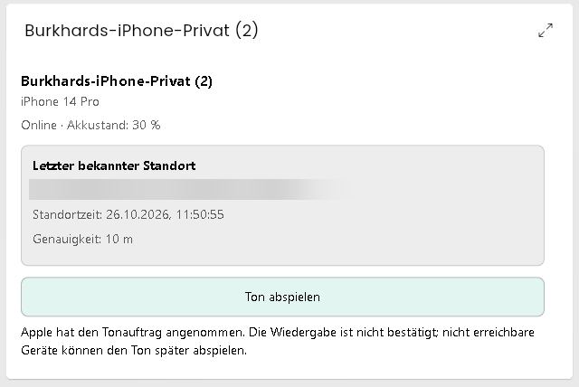
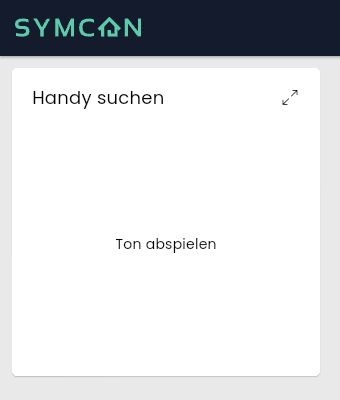

# iCloud Gerät

**Eine Instanz gehört zu einem Apple-Gerät.** Sie stellt dessen Akku-, Geräte-
und Standortdaten als Symcon-Variablen bereit. Damit lassen sich zum Beispiel
ein niedriger Akkustand anzeigen oder Standortdaten in eigenen Automationen
verwenden. Zusätzlich können ein Suchton und der Verloren-Modus ausdrücklich
ausgelöst werden. Welche Daten und Aktionen verfügbar sind, hängt vom Gerät
und den von Apple gelieferten Angaben ab.

Eine eigene Kartenansicht gehört nicht zu dieser Instanz. Dafür gibt es
[WoIst](../iCloud%20WoIst/README.md). Für Zonen und Gesamtanwesenheit mehrerer
Geräte ist [iCloud Anwesenheit](../iCloud%20Presence/README.md) zuständig.
Beide Module funktionieren auch ohne einzelne Geräteinstanzen.

- [Gerät einrichten](#einrichtung)
- [Gerätekachel mit Standort](#gerätekachel-mit-standort)
- [Aktualität und fehlende Daten verstehen](#aktualität-und-fehlende-daten)
- [Handy suchen](#handy-suchen)
- [Verloren-Modus](#verloren-modus)
- [Adresse anzeigen](#adresse-aus-woist)
- [Variablen nachschlagen](#variablen)
- [PHP-Funktionen für eigene Skripte](#öffentliche-funktionen)

## Einrichtung

Voraussetzung sind Symcon 9.0, PHP 8.5 und ein bereits angemeldetes
[iCloud Konto](../iCloud%20Account/README.md) aus dieser Library.

1. Den [iCloud Geräte Konfigurator](../iCloud%20Device%20Configurator/README.md)
   öffnen und mit dem gewünschten iCloud-Konto verbinden.
2. Das gewünschte Gerät in der Liste **Geräte** auswählen und die Instanz über
   **Erstellen** anlegen. Die Geräte-ID wird dabei automatisch übernommen.
3. Die angelegte Instanz **iCloud Gerät** öffnen. Prüfen, dass als übergeordnete
   Instanz dasselbe iCloud-Konto verbunden ist, und **Übernehmen** wählen.
   Gemeint ist die Datenverbindung; der Ordner im Objektbaum ist dafür unerheblich.
4. Im Objektbaum unterhalb der Instanz die Variablen prüfen. **Kontodaten
   verfügbar** zeigt an, ob das Gerät in den verfügbaren Kontodaten enthalten ist.
5. Für ein weiteres Gerät diese Schritte wiederholen. Passwort und
   Zwei-Faktor-Code werden ausschließlich im Konto eingegeben.

Ohne Programmierung lassen sich die angelegten Variablen als einzelne Kacheln
oder in der Listendarstellung der Instanz verwenden. Diese Geräteinstanz besitzt
keinen eigenen Kachel- oder IPSView-Designer.

## Gerätekachel mit Standort

Für die komfortable Ansicht die **Geräteinstanz** zur Kachelvisualisierung
hinzufügen und **Instanzspezifische Darstellung** wählen. Die Gerätekachel zeigt
Name, Modell, Online-Status, verfügbaren Akkustand sowie **Letzter bekannter
Standort** und **Ton abspielen** gemeinsam. Die einzelne Aktionsvariable
**Handy suchen** bleibt als einfache Tasterkachel verwendbar.



*Gerätekachel mit Standortzeit, Genauigkeit und Suchton-Rückmeldung.
Die Adresszeile ist für die Dokumentation unkenntlich gemacht.*

Wenn eine [WoIst-Adressquelle](#adresse-aus-woist) eine Adresse liefert, wird
sie angezeigt; sonst erscheinen Breiten- und Längengrad. Standortzeit und
verfügbare Genauigkeit gehören immer zum angezeigten Standort. Liegt noch
kein Standort vor, erscheint ein entsprechender Hinweis statt `0, 0`.

Bei fehlenden Standortdaten oder vorübergehend nicht verfügbarem Konto bleibt
der letzte bekannte Ort erhalten. Die Kachel warnt, wenn Apple ihn als alt
meldet, aktuell kein Standort verfügbar ist, die Standortzeit fehlt oder mehr
als 15 Minuten zurückliegt. Diese Warnung verändert nicht die Bedeutung der
Variable **Standort veraltet**. Ein Geräte- oder Kontowechsel löscht den
bisherigen Ort einschließlich seiner Adresse.

Die Darstellung verwendet die Farben des Symcon-Designs, unterstützt helle und
dunkle Ansichten und lässt sich bei kleinen Kacheln mit dem Mausrad scrollen.
Datenupdates aktualisieren den Inhalt ohne Neuladen und erhalten die
Scrollposition. Das Öffnen der Kachel, Standortupdates und Wiederverbindung
spielen keinen Ton ab und lösen keinen zusätzlichen Apple-Abruf aus.
**Ton abspielen** sendet erst beim ausdrücklichen Anklicken einen Auftrag.
Während der Rückmeldung ist der Taster gesperrt; ein unbestätigter Auftrag wird
nicht automatisch wiederholt. Bei nicht verfügbaren Kontodaten ist er deaktiviert.

## Konfiguration

| Formularfeld | Property | Typ | Standard | Bedeutung |
| --- | --- | --- | --- | --- |
| Übergeordnetes iCloud-Konto | keine Property | Verbindung | keine Verbindung | Konto, dessen Geräteliste verwendet wird; nach der Anlage prüfen |
| Geräte-ID | `DeviceID` | string | leer | Wird vom Konfigurator eingetragen. Die Apple-Gerätekennung ist weder der sichtbare Gerätename noch die Seriennummer oder IMEI. |
| WoIst-Adressquelle (optional) | `AddressSource` | int | keine Auswahl | Automatische Verwendung genau einer geeigneten WoIst-Karte desselben Kontos; bei mehreren Karten eine auswählen |

Die Geräte-ID normalerweise unverändert lassen. **Ein Wechsel der Geräte-ID
oder Kontoverbindung setzt die bisherigen Gerätewerte zurück.**

**Gespeicherte Kontodaten lesen** übernimmt den letzten gespeicherten Stand des
Kontos. Dieser Zwischenspeicher wird im Folgenden auch **Kontocache** genannt.
Der Button fragt Apple nicht ab. Neue Apple-Daten werden im Konto oder im
Konfigurator mit **Geräte bei Apple aktualisieren** angefordert. Das Konto
aktualisiert seine Geräteliste standardmäßig außerdem alle 300 Sekunden.
Neue Kontodaten werden automatisch an die Geräteinstanz weitergegeben.

## Aktualität und fehlende Daten

**Kontodaten verfügbar**, **Online** und **Standort verfügbar** sind verschiedene
Aussagen. Ein Gerät kann offline sein und trotzdem einen letzten bekannten
Standort besitzen. Ein erfolgreicher Kontoabruf bedeutet umgekehrt nicht, dass
Apple gerade eine neue GPS-Position ermittelt hat.

| Anzeige | So ist sie zu lesen |
| --- | --- |
| Kontodaten verfügbar | Das Gerät wurde in den verfügbaren Daten seines Kontos gefunden. |
| Online | Apple meldet Gerätestatus `200`. Dies ist kein zusätzlicher Erreichbarkeitstest durch Symcon. |
| Standort verfügbar / Standortzeit | Koordinaten wurden geliefert; die Standortzeit zeigt, von wann die Position stammt. |
| Standort veraltet | Apple kennzeichnet die Position als alt, die Alterskennzeichnung fehlt/ist ungültig oder aktuell ist kein Standort verfügbar. Für eigene Altersgrenzen zusätzlich die Standortzeit auswerten. |
| Genauigkeit | Von Apple gemeldeter Radius in Metern; ein kleinerer positiver Wert ist genauer. `0` bestätigt keine metergenaue Position. |
| Letzter erfolgreicher Geräteabruf | Zeitpunkt des Kontoabrufs, nicht der Ermittlung der GPS-Position. |

Fehlt ein Standort, bleiben die letzten gültigen Koordinaten und deren
Zeitstempel stehen; **Standort verfügbar** wird **Nein**. Entsprechend bleibt
bei fehlenden Akkudaten der letzte Akkustand stehen, während **Akkustand
verfügbar** **Nein** zeigt. In Automationen immer die Verfügbarkeit und bei
Standorten zusätzlich das Alter prüfen, bevor diese Werte verwendet werden.

Das Formular unterscheidet folgende Instanzzustände:

| Status | Bedeutung und nächster Schritt |
| --- | --- |
| 102 – Aktiv | Das Gerät ist in den verfügbaren Kontodaten vorhanden; einzelne Angaben können trotzdem fehlen. |
| 201 – Konto und Gerät auswählen | Kontoverbindung und Geräte-ID prüfen; vorzugsweise den Konfigurator verwenden. |
| 202 – Kontodaten nicht verfügbar | Im Konto Anmeldestatus, Abfragepause und eventuelle Wartefristen prüfen. |
| 203 – Gerät nicht in aktueller Kontoliste | Im Konfigurator die Kontozuordnung und die gespeicherte Geräteliste prüfen. Die Instanz wird nicht automatisch gelöscht. |

## Geräteaktionen

### Handy suchen

Die Aktionsvariable **Handy suchen** (`PlaySound`) stellt in der Kachelvisualisierung
einen Taster **Ton abspielen** bereit. Nach dem Modulupdate einmal die
Instanzkonfiguration übernehmen, damit die Variable angelegt wird. Diese Variable
oder eine Verknüpfung darauf als eigene Kachel hinzufügen und die Darstellung
**Aufzählung** verwenden; sie ist bereits vom Modul voreingestellt. In der
Listendarstellung der Geräteinstanz ist die Aktion ebenfalls bedienbar.
Ein zusätzliches Aktionsskript ist nicht erforderlich.



*Screenshot der nativen Kachel aus der MCP-Vorschau. Die Darstellung kann je
nach Symcon-Version, Kachelgröße und Design abweichen.*

Der Taster und der Formularbutton **Handy suchen (Ton abspielen)** senden
denselben einmaligen Suchton-Auftrag für das
konfigurierte Gerät über dessen verbundenes iCloud-Konto. Das Gerät muss im
Cache dieses angemeldeten Kontos vorhanden sein. Der Button verwendet immer
die gespeicherte Gerätezuordnung; eine andere Ziel-ID kann beim Aufruf nicht
übergeben werden.

Die Rückmeldung im Formular unterscheidet einen von Apple angenommenen Auftrag
von einer fehlgeschlagenen oder nicht bestätigten Anfrage. Eine Annahme ist kein
Nachweis, dass das Gerät bereits hörbar klingelt. Ein nicht erreichbares Gerät
kann den Ton später beim Wiederverbinden abspielen. Den Ton bei Bedarf am
Gerät beenden; Apple kann eine Bestätigungs-E-Mail senden.

Bei Fehlern wird der Auftrag nicht automatisch erneut gesendet. Insbesondere
nach einem Verbindungsabbruch zuerst das Gerät prüfen, bevor erneut ausgelöst
wird. Eine abgelaufene Sitzung erfordert zunächst die Wiederherstellung der
Kontositzung; die Tonaktion startet keine Passwortanmeldung. Apple-Sperrfristen
gelten gemeinsam für alle Anfragen dieses Kontos.

Formularöffnung, Konfigurationsübernahme, Cacheupdates und Timer spielen keinen
Ton ab. Die Gerätevariablen bleiben lesbar und behalten ihre bisherigen IDs.

### Verloren-Modus

Im Instanzformular unter **Verloren-Modus** das angezeigte Zielgerät prüfen.
Bei Bedarf eine **Rückrufnummer** und eine **Nachricht auf dem Sperrbildschirm**
(höchstens 160 Zeichen, einzeilig) eingeben. Die Angaben werden beim Auslösen
an Apple gesendet und können auf dem verlorenen Gerät erscheinen.

**Neuer Gerätecode** bleibt bei einem bereits vorhandenen Code leer. Nur wenn
Apple für das Gerät einen neuen Code benötigt, einen vier- oder sechsstelligen
Zifferncode eingeben und sicher zum späteren Entsperren aufbewahren. Apple kann
für bestimmte Geräte oder Familienfreigaben weitere Schritte verlangen; diese
gegebenenfalls direkt in **Wo ist?** durchführen. Das Modul umgeht keine
Apple-Zugriffsbeschränkungen.

**Verloren-Modus aktivieren** öffnet vor jedem Auftrag einen Ja/Nein-Dialog.
Erst **Ja** sendet die Aktivierung für das gespeicherte Gerät. Der Modus kann
das Gerät sperren und Apple Pay aussetzen. Bei nicht erreichbaren Geräten kann
die Aktivierung später erfolgen. Abbrechen oder **Nein** sendet keinen Auftrag.
Die Felder sind flüchtige Aktionsdaten, keine gespeicherten Einstellungen;
nach einem Aufruf werden sie geleert. Kontaktangaben, Gerätecode und rohe
Apple-Antworten werden nicht im Modulzustand oder in Diagnosemeldungen abgelegt.

Die Aktivierungsaktion verlangt ein angemeldetes Konto und ein Gerät aus dessen Cache mit
ausdrücklich gemeldeter Verloren-Modus-Unterstützung. Fehlende oder unbekannte
Unterstützung und ein bereits aktivierter Modus werden abgewiesen. Das Formular
meldet Annahme oder Fehler. **Verloren-Modus aktiviert** (`LostModeEnabled`)
wird nicht anhand der Auftragsannahme gesetzt, sondern erst mit dem nächsten
regulären Kontoupdate aus dem gemeldeten Gerätezustand übernommen.

Bei Fehlern oder unbestätigtem Ergebnis gibt es keine automatische Wiederholung.
Vor einem weiteren Auftrag den Zustand in **Wo ist?** prüfen. Sitzung,
Kontosperrfristen und Gerätezuordnung gelten wie beim Suchton. Formularöffnung,
Konfigurationsübernahme, Cacheupdates und Timer aktivieren den Modus nicht.
Es gibt keinen unbestätigten Verloren-Modus-Taster in der Kachel.

Zum Beenden im selben Formularbereich **Verloren-Modus deaktivieren** wählen
und den eigenen Ja/Nein-Dialog bestätigen. **Nein** sendet keinen Auftrag.
Diese Aktion verwendet keine Rückrufnummer, Nachricht oder Codeeingabe. Sie
kann auch bei bisher mit **Nein** oder **Nicht verfügbar** gemeldetem Zustand
angefordert werden, um einen noch unbestätigten Aktivierungsauftrag zu beenden.
Auch dabei muss Apple die Unterstützung für dieses Gerät melden.

Die Rückmeldung bestätigt lediglich die Annahme des Auftrags. Bei nicht
erreichbaren Geräten kann die Bearbeitung später erfolgen. Die Variable
`LostModeEnabled` bleibt bis zur nächsten Apple-Gerätemeldung unverändert.
Eine Deaktivierung entfernt weder den Gerätecode noch die Aktivierungssperre;
das Gerät kann weiterhin gesperrt bleiben. Falls Apple zusätzliche Schritte
verlangt, **Wo ist?** verwenden oder das Gerät gemäß Apple entsperren.
Siehe [Apples Anleitung zum Verloren-Modus](https://support.apple.com/de-de/guide/icloud/mmfc0f0165/icloud).

## Adresse aus WoIst

Für die Variable **Adresse** muss in einer [WoIst-Karte](../iCloud%20WoIst/README.md#optionale-adressauflösung)
am selben iCloud-Konto die Adressauflösung mit Nominatim oder Geoapify eingerichtet und aktiviert
sein. Die Geräteinstanz übernimmt ausschließlich die dort bereits aufgelöste
Adresse; sie benötigt keine eigene Serveradresse und startet keine zusätzliche
Anbieterabfrage oder einen eigenen Abfragetimer. Bei Geoapify gelten Tagesbudget
und Genauigkeitsregeln der ausgewählten WoIst-Instanz. Bei eigenen Anzeigen der
Adressvariable die Quellenhinweise von Geoapify und OpenStreetMap beibehalten.

Beide Anbieter liefern die kompakte Darstellung **Straße Hausnummer, PLZ Ort,
Land**. Die Gerätevariable übernimmt denselben Text wie die Karte, einschließlich
der von der Standortgenauigkeit abhängigen Detailstufe und des Ungefähr-Hinweises.

**WoIst-Adressquelle (optional)** (`AddressSource`, Standard `0`) kann leer
bleiben, wenn genau eine Karte mit aktivierter Adressauflösung an diesem Konto
vorhanden ist. Bei mehreren solchen Karten die gewünschte Instanz ausdrücklich
auswählen. Eine Quelle an einem anderen Konto wird nicht verwendet, auch wenn
die Geräte-ID identisch ist. Eine ungültige Quelle beeinträchtigt die übrigen
Gerätevariablen nicht.

Nach dem Modulupdate die Geräteinstanzkonfiguration einmal übernehmen, damit
die neue Variable angelegt wird. Vorhandene Cachetreffer erscheinen sofort;
später aufgelöste Adressen werden von WoIst automatisch an die Geräteinstanz
weitergegeben. Für die Übernahme ist keine Apple-Aktualisierung erforderlich.
Nach dem Löschen oder Umverbinden einer Quelle wird deren Zuordnung beim
nächsten Geräteupdate erneut geprüft.

## Variablen

Die Statusvariablen sind ausschließlich lesbar. **Handy suchen** ist die einzige
Aktionsvariable; ihr Wert ist kein Wiedergabestatus. Die technischen Kennungen
in der ersten Spalte sind für Skripte gedacht. Im Objektbaum erscheinen die
deutschen Anzeigenamen wie **Akkustand**, **Standortzeit** und **Adresse**.

| Anzeige | Technischer Ident | Typ | Bedeutung / Einheit |
| --- | --- | --- | --- |
| Handy suchen | `PlaySound` | int, Aktion | Taster **Ton abspielen**; `1` löst einmalig aus, `0` ist der neutrale Wert und kein Wiedergabestatus |
| Kontodaten verfügbar | `DataAvailable` | bool | Gerät in der erfolgreich abgerufenen Kontoliste vorhanden |
| Online | `Online` | bool | Von Apple gemeldeter Gerätestatus 200 |
| Gerätename / Modell / Geräteklasse | `DeviceName`, `Model`, `DeviceClass` | string | Gerätebezeichnung und Typ |
| Gerätestatus | `DeviceStatus` | int | Technischer Gerätestatus von Apple |
| Akkustand verfügbar | `BatteryAvailable` | bool | Akkustand vorhanden |
| Akkustand | `BatteryLevel` | float | Akkustand in Prozent |
| Akkustatus | `BatteryStatus` | string | Von Apple gelieferter Statustext, beispielsweise `NotCharging` |
| Standort verfügbar | `LocationAvailable` | bool | Koordinaten in der letzten Antwort vorhanden |
| Standort veraltet | `LocationIsOld` | bool | Standort als veraltet gemeldet, Alterskennzeichnung unbekannt oder aktuell nicht verfügbar |
| Breitengrad / Längengrad | `Latitude`, `Longitude` | float | Koordinaten in Grad |
| Adresse | `Address` | string | Aufgelöste Adresse aus der ausgewählten WoIst-Karte |
| Genauigkeit | `Accuracy` | float | Letzter bekannter Genauigkeitsradius in Metern; nur bei `AccuracyAvailable=true` zur verfügbaren Position gehörend |
| Genauigkeit verfügbar | `AccuracyAvailable` | bool | Bekannter Genauigkeitsradius zur verfügbaren Position |
| Standortzeit | `LocationTimestamp` | int | Zeitpunkt der Position, als Datum/Uhrzeit angezeigt; für Skripte Unix-Sekunden |
| Letzter erfolgreicher Geräteabruf | `LastUpdate` | int | Zeitpunkt des Kontoabrufs, als Datum/Uhrzeit angezeigt; für Skripte Unix-Sekunden |
| Stromsparmodus | `LowPowerMode` | int | Von Apple gemeldeter Zustand |
| Ortung aktiviert / Ortung unterstützt | `LocationEnabled`, `LocationCapable` | int | Aktivierung beziehungsweise Unterstützung der Ortung |
| Ortung läuft | `IsLocating` | int | Ortung läuft laut Apple |
| Verloren-Modus aktiviert / unterstützt | `LostModeEnabled`, `LostModeCapable` | int | Zustand beziehungsweise Unterstützung des Verloren-Modus |
| Aktivierungssperre | `ActivationLocked` | int | Von Apple gemeldete Aktivierungssperre |
| Familienfreigabe | `FamilyShared` | int | Kennzeichnung der Familienfreigabe laut Apple |
| Standort von Apple als ungenau gemeldet | `LocationIsInaccurate` | int | Apples zusätzliche Kennzeichnung zur vorhandenen Position |
| Ortung abgeschlossen | `LocationFinished` | int | Ortung für den vorhandenen Standort laut Apple abgeschlossen |
| Technische Modellkennung | `ModelIdentifier` | string | Modellkennung oder **Nicht verfügbar** |

Die zehn zusätzlichen Statusvariablen verwenden drei klar unterscheidbare Werte:
**-1 = Nicht verfügbar**, **0 = Nein**, **1 = Ja**. Für Skripte ausdrücklich
auf `0` oder `1` prüfen; eine Umwandlung in Boolean würde `-1` falsch auswerten.
Fehlende, leere oder ungültige Angaben werden nicht als Nein interpretiert.
Die Anzeige übernimmt die von Apple gelieferten Kennzeichnungen; insbesondere
belegt ein fehlender Wert weder Unterstützung noch Aktivierung einer Funktion.
`LocationIsInaccurate` ist Apples zusätzliche Kennzeichnung und ersetzt nicht
die metrische `Accuracy` oder die Genauigkeitsregeln der Adressauflösung.

In Symcon erscheinen die lesbaren Texte **Nicht verfügbar**, **Nein** und **Ja**.
Die numerischen Werte bleiben für Skripte und Archivierung erhalten. Nicht jedes
Gerät liefert alle Angaben; **Nicht verfügbar** ist deshalb nicht automatisch
ein Konfigurationsfehler.

Nach dem Update die Geräteinstanzkonfiguration übernehmen. Alte Kontocaches
bleiben lesbar; die neuen Angaben zeigen zunächst **Nicht verfügbar**, bis die
nächste erfolgreiche Geräteabfrage im Konto die zusätzlichen Felder liefert.
Die Geräteinstanz selbst startet für diese Statusanzeigen keinen Netzwerkabruf.
Suchton und bestätigte Aktivierung des Verloren-Modus sind getrennte,
ausdrücklich auszulösende Aktionen.

Anders als die bisherigen historischen Koordinaten werden die neuen
Statusangaben und die technische Modellkennung bei fehlenden Daten, abgelaufener
Kontositzung, entferntem Gerät oder Wechsel der Gerätezuordnung unmittelbar
auf **Nicht verfügbar** gesetzt. Fehlt nur die Position, bleiben die übrigen
Geräteangaben nutzbar; nur die beiden zusätzlichen Standortstatus sind unbekannt.

Bei Kontofehlern oder einem nicht mehr gelisteten Gerät werden die
Verfügbarkeitsanzeigen und **Online** auf **Nein** gesetzt. Die übrigen
gespeicherten Werte und Zeitstempel bleiben zur Einordnung erhalten; die
zusätzlichen Statusangaben verwenden dagegen **Nicht verfügbar** wie oben
beschrieben. Die Regeln aus [Aktualität und fehlende Daten](#aktualität-und-fehlende-daten)
gelten auch für eigene Skripte.

`Address` bleibt leer, wenn kein eindeutiger aktivierter Adresslieferant oder
kein passender Cachetreffer vorhanden ist. Die Adresse wird bei einem
Positionswechsel nicht von der vorherigen Position übernommen. Fehlende
Positionen, Kontofehler, entfernte Geräte und das Deaktivieren der Auflösung
leeren die Adresse bei der jeweiligen Aktualisierung. Eine veraltete, aber
weiterhin verfügbare Position kann eine Adresse besitzen; deren Alter zeigt
`LocationIsOld`. Die Adresse beschreibt das vom gewählten Anbieter gefundene nahegelegene
OSM-Objekt und garantiert keine genaue Hausnummer.

Die [Genauigkeitsregeln der WoIst-Adressauflösung](../iCloud%20WoIst/README.md#optionale-adressauflösung)
gelten auch für `Address`: Gebäude werden nur bis einschließlich 20 m angezeigt.
Bei geringerer Genauigkeit enthält die Variable die gröbere Adresse mit dem
Präfix **Ungefähr** und der jeweiligen Detailstufe. Unbekannte Genauigkeit wird
ausdrücklich benannt. Verbessert sich die Position, entfällt der Hinweis wieder.

## Öffentliche Funktionen

`ICID_Update(int $InstanceID): bool` liest das Gerät aus dem Kontocache. `true` bedeutet, dass das Gerät in einer erfolgreich abgerufenen Liste vorhanden ist. Die Funktion und **Gespeicherte Kontodaten lesen** starten keinen Netzwerkabruf. Für neue Apple-Daten die Geräteabfrage im Konto oder Konfigurator verwenden.

`ICID_PlaySound(int $InstanceID): bool` sendet den Suchton-Auftrag für genau
dieses Gerät. `true` bedeutet, dass Apple den Auftrag angenommen hat; bei
Ablehnung, fehlender Sitzung, falscher Zuordnung oder einem Transportfehler
wird `false` geliefert. Ein Formularhinweis enthält das letzte Aktionsergebnis.
Das Skript kann die Funktion gezielt aus einer Automation aufrufen.

Alternativ `RequestAction($PlaySoundVariablenID, 1)` für die Aktionsvariable
verwenden. Diese bleibt nach Erfolg und Fehler auf `0`, damit jeder weitere
Tastendruck wieder einen ausdrücklichen Auftrag auslösen kann. Fehler werden
bei der Variablenaktion an den Client zurückgemeldet; der letzte Hinweis bleibt
auch im Instanzformular sichtbar. Ein direktes Setzen eines Wertes ersetzt
keinen Aktionsaufruf und startet keine Wiedergabe.

`ICID_ActivateLostMode(int $InstanceID, bool $Confirmed, string $PhoneNumber,
string $Message, string $NewPasscode): bool` aktiviert den Verloren-Modus für
das konfigurierte Gerät. `$Confirmed` ist bei jedem Aufruf ausdrücklich
anzugeben; `false` führt keine Anfrage aus. Die übrigen Parameter können leer
sein. `true` als Ergebnis bestätigt ausschließlich die Annahme durch Apple.
Skripte müssen die Bestätigung vor dem Aufruf selbst einholen; der PHP-Aufruf
öffnet keinen Dialog. Kontaktangaben und Code nicht in Skripten fest hinterlegen
oder protokollieren. Bestehende Variablen und ihre IDs bleiben erhalten.

`ICID_DeactivateLostMode(int $InstanceID, bool $Confirmed): bool` sendet einen
einmaligen Auftrag zum Beenden des Verloren-Modus für das konfigurierte Gerät.
`$Confirmed` muss für jeden Aufruf ausdrücklich angegeben werden; `false`
sendet keinen Auftrag. Skripte holen die Bestätigung selbst ein. `true` als
Ergebnis bedeutet ausschließlich, dass Apple den Auftrag angenommen hat.
Gerätezuordnung, Sitzung, Sperrfristen und Verzicht auf automatische
Wiederholungen gelten wie bei der Aktivierung. Ein Fehler führt niemals zu
einem ersatzweisen Aktivierungsauftrag.

## Skriptbeispiel und Datenqualität

Die Instanz-ID bezeichnet das **iCloud-Gerät**. Gerätekennungen werden vom
Konfigurator übernommen oder aus `ICAC_GetDevices` des verbundenen Kontos
gewonnen. `DeviceID` ist ein String (Vorgabe `''`); `AddressSource` ist eine
Instanz-ID als Integer (Vorgabe `0`, automatische eindeutige Auswahl).

```php
$instanceID = 12345; // Durch die eigene Geräteinstanz ersetzen.
$result = ICID_Update($instanceID); // Liest ausschließlich den Kontocache.
$available = GetValue(IPS_GetObjectIDByIdent('AccuracyAvailable', $instanceID));
if ($result && $available) {
    $accuracy = GetValue(IPS_GetObjectIDByIdent('Accuracy', $instanceID));
    echo 'Genauigkeitsradius: ' . $accuracy . ' m';
}
```

`AccuracyAvailable` (Boolean, **Genauigkeit verfügbar**) ist nur bei gültiger
Position und bekanntem, nicht negativem Genauigkeitswert wahr. Auch `0 m` ist
ein vorhandener Wert. Bei fehlender Genauigkeit bleibt `Accuracy` als
historischer Zahlenwert erhalten; ohne `AccuracyAvailable` darf er nicht der
aktuellen Position zugeordnet werden. Bei Kontofehlern, Gerätewechsel oder
fehlender Position ist die Verfügbarkeit falsch. Die Gerätekachel übernimmt
unbekannte Genauigkeit als `null` und zeigt keinen erfundenen Genauigkeitswert.
Ein bekannter Wert `0 m` wird ausdrücklich angezeigt. Bei älteren Installationen
wird die neue Verfügbarkeitsvariable auch durch das erste Cacheupdate oder eine
Kontobenachrichtigung vor dem manuellen Übernehmen angelegt. Bestehende
Variablen werden dabei weder neu angelegt noch umbenannt.

Ältere gespeicherte Standorte konnten fehlende Genauigkeit als `0` enthalten.
Ein solcher unmarkierter historischer Nullwert wird beim Lesen als unbekannt
übernommen, sofern er nicht eindeutig zur noch verfügbaren Messung mit bekannter
Nullgenauigkeit passt. Positive historische Genauigkeit, Koordinaten, Standortzeit
und Adresse bleiben erhalten. Neu bestätigte `0 m` werden intern als bekannt
gespeichert und bleiben auch nach Standortverlust oder erneutem Laden sichtbar.
Die interne Herkunftskennzeichnung wird nicht an Skripte oder die Kachel ausgegeben.

`location.isOld` im Kontocache und `LocationIsOld` bleiben Boolean. Nur Apples
explizites `false` gilt als nicht alt; fehlende oder ungültige Kennzeichnungen
werden vorsorglich als alt behandelt. Auch `false` garantiert keine Aktualität:
für eigene Automationen Standortzeit und eigene Altersgrenze berücksichtigen.
Alte Caches mit fehlender Kennzeichnung werden ebenso konservativ behandelt.
Bestehende Variablen behalten Typ, Ident und ID; die neue Verfügbarkeit ergänzt
den Vertrag. Eigene Variablennamen und Symbole bleiben erhalten.

`Update=true` bestätigt ein im authentifizierten Cache gefundenes Gerät,
nicht einen neuen Apple-Abruf. `PlaySound=true` und die beiden Verloren-Modus-
Funktionen bestätigen nur die Annahme des Auftrags. Bei `false` wurde keine
Annahme bestätigt; eine unklare Transportantwort darf nicht automatisch erneut
versendet werden. Die Parametergrenzen und die persönliche Bestätigung für
den Verloren-Modus stehen im entsprechenden Bedienabschnitt. Die Geräteinstanz
bietet eine native Kachel; eine eigene IPSView- oder WebFront-HTML-Ausgabe wird
nicht angeboten. Einzelvariablen bleiben unabhängig davon nutzbar.

## Lizenz

PolyForm Noncommercial License 1.0.0; siehe [LICENSE](../LICENSE).
