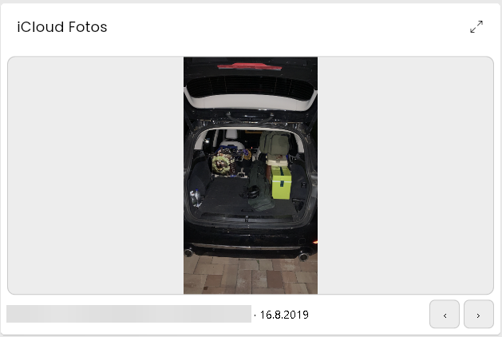

# iCloud Fotos

Ein Fotoalbum als **Widget in der Kachelvisualisierung** oder als optionale
**IPSView-WebContent-Variable**. Einzelbild und Diashow verwenden denselben
lesenden Kontozugang. Es werden keine Bilder hochgeladen, verändert oder gelöscht.



*Beispiel der Fotoanzeige mit Vor-/Zurück-Schaltflächen. Der private Dateiname
ist für die Dokumentation unkenntlich gemacht.*

## Voraussetzungen und Einrichtung

Symcon 9.0, PHP 8.5 mit `curl` und `bcmath` sowie ein bereits angemeldetes
[iCloud Konto](../iCloud%20Account/README.md) mit aktiviertem „Wo ist?“.

1. Im Konto unter **iCloud Fotos (optional)** den lesenden Fotozugriff aktivieren,
   Ressourcenprofil auswählen und die Konfiguration übernehmen.
2. **Fotozugriff prüfen und Alben laden** wählen. Fotos benötigen den
   [iCloud-Webzugriff](https://support.apple.com/de-de/102630). Bei erweitertem
   Datenschutz kann eine Freigabe auf einem vertrauenswürdigen Gerät nötig sein.
   Das Modul verändert diese Apple-Einstellungen nicht.
3. Eine **iCloud Fotos**-Instanz anlegen und mit diesem Konto verbinden.
   **Alben laden** aktualisiert die Auswahl. Ein persönliches Album, **Favoriten**
   oder **Alle Fotos** auswählen, das Widget aktivieren und übernehmen.
4. **Fotos aktualisieren** lädt die ersten Metadaten. Anschließend die Instanz
   als instanzspezifische Kachel hinzufügen. Für IPSView die Ausgabe im
   **IPSView-Designer** aktivieren, übernehmen und **Fotos für IPSView** einbinden.

Der Server wird normalerweise automatisch erkannt. Die optionale Server-URL
enthält nur den HTTP(S)-Ursprung mit gegebenenfalls Port, beispielsweise
`https://symcon.example:3777`, ohne weiteren Pfad. Der Client muss ihn erreichen
können; bei einer HTTPS-Ansicht ist ebenfalls HTTPS erforderlich.

Die Geräteinstanzen und die WoIst-Karte sind dafür nicht erforderlich. Für ein
anderes Album kann eine weitere Foto-Instanz am selben Konto verwendet werden;
das Ressourcenbudget des Kontos gilt für alle diese Instanzen gemeinsam.

## Bedienung und Designer

Kacheldesigner und IPSView-Designer besitzen unabhängige Vorgaben für Einzelbild
oder Diashow, vollständiges Bild oder zugeschnittenen Rahmen, Beschriftung,
Intervall (5–3600 Sekunden) und zufällige Reihenfolge innerhalb jeder geladenen
Seite. Ohne Zufall folgt die Ausgabe Apples absteigender Albumreihenfolge.
**Alle Fotos** ist nach Hinzufügung sortiert, einzelne Alben nach Aufnahmedatum.

Die Pfeile wechseln das Bild, die Diashow lässt sich pausieren. Das Mausrad über
dem Bild blättert vor/zurück; über langen Beschriftungen scrollt es den Text.
Am Ende wird wieder am Anfang begonnen. Beim Rückwärtsblättern über eine
Seitengrenze wird die vorherige Metadatenseite geladen. Die erste Version zeigt
JPEG-Vorschauen statischer Fotos; Videos, ausgeblendete und gelöschte Bilder
werden übersprungen. Live Photos erscheinen als Standbild. Geteilte Mediatheken,
geteilte Alben, Original-/HEIC-Downloads und Videoausgabe sind nicht enthalten.

Die vorhandenen zentralen Theme- und IPSView-Stilhelper liefern Hell-/Dunkelmodus,
Farben und Schrift. Beide Designer enthalten eine zum Foto-Widget passende
Farbkarte mit den deutschen Feldbezeichnungen. Das Motiv selbst wird nicht
eingefärbt. Die Kachel reserviert Platz für einen sichtbaren Symcon-Titel.

Aktuelles Bild, Pause und Beschriftungs-Scrollposition bleiben bei Datenupdates
und kurzen Verbindungsunterbrechungen erhalten. Sitzungswerte im Client erlauben
auch die Wiederherstellung nach einem Dokumentwechsel, sofern dessen Webview
Sitzungsspeicher unterstützt. Ein anderes Konto/Album beginnt mit einer neuen
Auswahl. Bei entzogenem Zugriff wird das angezeigte Bild entfernt.

## Ressourcen und Daten

| Kontoprofil | Maximal gespeicherte Bilder | Bilddateien auf Datenträger |
| --- | ---: | ---: |
| Kompakt (Standard) | 50 | 100 MiB |
| Standard | 250 | 500 MiB |
| Groß | 1000 | 2 GiB |
| Eigene Grenzen | 1–100000 | 1–65536 MiB |

Es gilt jeweils die zuerst erreichte Grenze. **Ein gemeinsamer Festplatten-Cache
pro Konto** verhindert doppelte Downloads durch mehrere Widgets. Länger nicht
verwendete Bilder werden bei Platzbedarf entfernt; reduzierte Grenzen greifen
beim Übernehmen. Kleine Indexdateien kommen zum Bildbudget hinzu. Der Cache ist
eine beschränkte Vorschauablage und keine Sicherung der Mediathek.

Größere Alben bleiben durch bedarfsgerechtes Nachladen von Metadaten erreichbar.
Der Browser hält nur das aktuelle Bild als Blob; er lädt nicht den kompletten
Kontocache in den Arbeitsspeicher. Pro Bild gelten 8 MiB und 20 Millionen Pixel
als feste Sicherheitsgrenzen. Nicht passende Vorschauen werden übersprungen.
Bilddaten werden über den zentralen `ChunkedJsonTransferHelper` in kleinen
JSON-Seiten zwischen Konto, Fotoinstanz und Browser übertragen. Auch größere
Vorschauen überschreiten dadurch nicht das Symcon-Ausgabelimit von 1 MiB.
Temporäre Transferdateien sind mit OpenSSL AES-256-GCM verschlüsselt und werden
nach dem Abruf freigegeben; abgebrochene Transfers laufen nach fünf Minuten ab.
Die PHP-Installation benötigt dafür OpenSSL mit AES-256-GCM.
Die Ressourcenprofile erkennen keine Hardware automatisch und reservieren
keinen RAM. Ausreichend freien Speicherplatz selbst sicherstellen.

Fotometadaten werden standardmäßig alle 900 Sekunden aktualisiert
(konfigurierbar 300–86400); der Albumkatalog spätestens beim nächsten Fotorefresh
nach einer Stunde. Bilddaten werden erst beim Anzeigen angefordert. Formularaufruf
und Konfigurationsübernahme starten keine Apple-Abfragen. **Alben laden** und
**Fotos aktualisieren** sind ausdrücklich ausgelöste lesende Abfragen.

Apple-Sitzung und signierte Bildadressen bleiben im Konto. Vorschauen liegen
unter `SymconiCloud/photos/<Konto-ID>` im Symcon-Kernelverzeichnis, außerhalb des
öffentlichen Web-Verzeichnisses. Die Ausgabe verwendet einen geschützten
HTTP-Hook. Tokens werden im URL-Fragment übergeben und anschließend nur als
Autorisierungsheader verwendet. HTML-Variablen und Symcon-Backups enthalten
vertrauliche Daten und müssen entsprechend geschützt werden. Deaktivieren des
Fotozugriffs, Abmelden und Ändern der Kontozugangsdaten leeren den Fotocache.

Apple bietet für diese Web-Anbindung keinen stabil zugesicherten API-Vertrag.
Fehlende Freigaben, vorbereitende Indizierung oder abgelaufene Sitzungen werden
als Hinweis angezeigt; es erfolgt keine automatische Passwort-Neuanmeldung.

## Konfiguration und IPSView-Variable

| Formularfeld | Property | Typ | Standard | Bedeutung |
| --- | --- | --- | --- | --- |
| Foto-Widget aktivieren | `Enabled` | bool | aus | Anzeige und regelmäßige Metadatenabfrage einschalten |
| Album | `AlbumID` | string | keine Auswahl | Persönliches Album, Favoriten oder Alle Fotos |
| Aktualisierungsintervall der Fotodaten in Sekunden | `RefreshInterval` | int | 900 s | Metadaten neu abrufen; 300 bis 86400 s, unabhängig vom Bildwechselintervall |

Das **Diashow-Intervall** wird dagegen im jeweiligen Designer eingestellt;
es beträgt standardmäßig 30 Sekunden. Ein Bildwechsel ist keine neue
Passwortanmeldung. Notwendige Bildvorschauen werden bedarfsgerecht geladen.

Das Modul legt keine Variablen für jedes einzelne Foto an. Bei aktivierter
IPSView-Ausgabe dient die String-Variable **Fotos für IPSView** (`IPSViewPhotos`)
als Einbindung. Die native Kachel wird direkt aus der Foto-Instanz dargestellt.
Bei Status **104** Aktivierung und Albumauswahl prüfen; bei **202** die Hinweise
zum Fotozugriff im verbundenen Konto beachten.

## PHP-Funktionen

| Funktion | Wirkung |
| --- | --- |
| `ICPH_RefreshAlbums(int $InstanceID): bool` | Albumkatalog lesend aktualisieren |
| `ICPH_Refresh(int $InstanceID): bool` | Erste Metadatenseite des konfigurierten Albums laden |
| `ICPH_GetIPSViewHTML(int $InstanceID): string` | Geschützte HTTP-Ausgabe einbetten |

## Skriptbeispiel und Rückgabeverträge

`AlbumID` ist ein String (Vorgabe `''`) aus der Albumauswahl des verbundenen
Kontos beziehungsweise `ICAC_GetPhotoAlbums`. Ein Albumname oder eine Apple-URL
ist keine Kennung. Auch `smart:favorites` und `smart:all` sind nur bei passendem
verfügbarem Katalog auswählbar. `Enabled` hat die Vorgabe `false`.
Die folgenden Angaben gelten für die **Foto-Instanz**, nicht für das Konto.

```php
$instanceID = 12345; // Durch die eigene Foto-Instanz ersetzen.
IPS_SetProperty($instanceID, 'RefreshInterval', 900);
IPS_ApplyChanges($instanceID);
$result = ICPH_GetIPSViewHTML($instanceID); // Lokale Einbindung, keine Apple-Anfrage.
```

`RefreshAlbums=true` bestätigt einen aktualisierten Albumkatalog im Konto.
`Refresh=true` bestätigt die erste Metadatenseite des gewählten Albums, nicht
sämtliche Fotos oder heruntergeladene Vorschauen. Diese beiden Funktionen
können Apple-Anfragen auslösen. Bei deaktivierter Instanz, fehlendem Album,
fehlender Verbindung, parallelem Vorgang oder abgewiesenem Zugriff ist `false`
möglich. Kontoschutz und Wartefristen bleiben wirksam. Der Fehlerhinweis steht
im Formular; aus `false` darf keine leere Bibliothek abgeleitet werden.
`GetIPSViewHTML` liefert die lokale HTML-Einbindung als String. Auch eine
zurückgegebene Einbindung oder Fehlerseite bestätigt kein erfolgreich geladenes
Foto. Die Einbindung enthält einen vertraulichen Lesezugang und gehört nicht in Logs oder Nachrichten.

Die Designer verwenden die Präfixe `Tile` und `IPSView`: `PhotoMode` ist ein
String mit `single` (Vorgabe) oder `slideshow`, `PhotoFit` ein String mit
`contain` (Vorgabe) oder `cover`, `PhotoSeconds` ein Integer mit Vorgabe 30,
`PhotoShuffle` ein Boolean mit Vorgabe `false` und `PhotoCaption` ein Boolean
mit Vorgabe `true`. Die zugehörigen Formularfelder heißen Darstellungsmodus,
Bildanpassung, Diashow-Intervall in Sekunden, zufällige Reihenfolge innerhalb
jeder geladenen Seite und **Dateiname und Datum anzeigen**. Das Diashow-Intervall
wird auf 5 bis 3600 Sekunden begrenzt. Die Felder wirken auf die Darstellung, nicht auf die Konto-Anmeldung. Die konkrete
Bedienung und Grenzen stehen in den Designerabschnitten. `IPSViewServerURL`
ist ein String mit Vorgabe `''`; eine gesetzte Adresse muss vom Client als
HTTP(S)-Ursprung erreichbar sein. Native Kachel und IPSView verwenden die
beschriebenen eigenen Ausgaben; eine separate WebFront-Diashow wird nicht
zugesichert.

## Lizenz

PolyForm Noncommercial License 1.0.0; siehe [LICENSE](../LICENSE).
