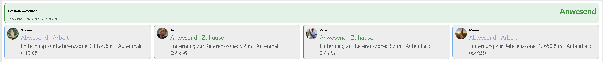
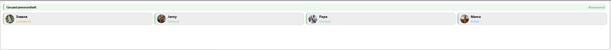

# iCloud Anwesenheit

Eine Instanz wertet **mehrere Geräte eines iCloud-Kontos** anhand gemeinsamer
kreisförmiger Zonen aus. Jedes Gerät besitzt eine eigene Anwesenheit,
Entfernung und Aufenthaltsdauer. Darüber steht die **Gesamtanwesenheit** der
Gruppe. Voraussetzung sind Symcon 9.0 und ein angemeldetes iCloud-Konto dieser
Library. Alle benötigten Bibliotheksbestandteile sind im Modulupdate enthalten.
Eine Geräteinstanz oder WoIst-Karte ist nicht erforderlich.

## Einrichtung

1. Im iCloud-Geräte-Konfigurator unter **Anwesenheitsgruppen** eine Gruppe
   erstellen oder **iCloud Anwesenheit** manuell anlegen. Mit dem gewünschten
   Konto verbinden. Der Konfigurator ordnet vorhandene Gruppen dem Konto zu.
2. Unter **Geräte** die gewünschten Geräte hinzufügen. Der optionale Anzeigename
   überschreibt den Namen aus dem Kontocache. Geräte dürfen nur einmal vorkommen;
   maximal 64 Geräte sind möglich. Zur Zuordnung dient die stabile Geräte-ID,
   nicht der Name oder die Reihenfolge.
3. Unter **Zonen** die gemeinsamen Zonen definieren und genau eine Referenzzone
   markieren. Diese Referenz gilt für alle ausgewählten Geräte.

   | Spalte | Bedeutung |
   | --- | --- |
   | Zonen-ID | Eindeutige stabile ID, etwa `home` oder `work`; beginnt mit einem Buchstaben, danach Buchstaben, Ziffern, `_` oder `-`; maximal 48 Zeichen |
   | Name | Angezeigter Name, maximal 80 Zeichen |
   | Breitengrad / Längengrad | Mittelpunkt in Dezimalgrad |
   | Radius | Kreisradius in Metern, 1 bis 1.000.000 |
   | Referenzzone | Genau eine Zone markieren, beispielsweise Zuhause |

4. GPS-Einstellungen prüfen und die Konfiguration übernehmen.

Eine bis 64 Zonen sind möglich. Bei Überlappungen hat eine eindeutig passende
Referenzzone Vorrang; sonst gilt die Reihenfolge der Zonenliste. Zonen und
GPS-Einstellungen werden für alle Geräte gemeinsam gepflegt. Die Berechnung
nutzt Koordinaten und Radien und benötigt keine Adressauflösung.

## Gesamtanwesenheit

| Anzeige | Bedeutung |
| --- | --- |
| Anwesend | Mindestens ein ausgewähltes Gerät ist bestätigt in der Referenzzone |
| Abwesend | Alle ausgewählten Geräte sind bestätigt außerhalb der Referenzzone |
| Unbekannt | Keines ist anwesend und mindestens eines ist unbekannt; ebenso bei leerer Geräteliste |

Ein unbekanntes oder fehlendes Gerät wird niemals als abwesend gezählt. Ein
anderes Gerät mit bestätigter Anwesenheit reicht weiterhin für Anwesend.

Die Gruppenvariablen sind ausschließlich lesbar:

| Ident | Typ | Bedeutung |
| --- | --- | --- |
| `Presence` | int | Gesamtanwesenheit: -1 Unbekannt, 0 Abwesend, 1 Anwesend, mit Klartextanzeige |
| `SelectedCount` | int | Anzahl ausgewählter Geräte |
| `PresentCount` | int | Geräte mit bestätigter Anwesenheit |
| `AbsentCount` | int | Geräte mit bestätigter Abwesenheit |
| `UnknownCount` | int | Geräte mit unbekannter Anwesenheit |
| `PendingCount` | int | Geräte, deren bestätigter Zustand noch auf eine weitere neuere Apple-Position wartet |
| `DataAvailable` | bool | Erfolgreicher Zugriff auf den authentifizierten Kontocache |
| `Reason` | string | Gruppenbewertung oder Konfigurations-/Kontofehler |

Für Automationen ausdrücklich auf `Presence == 0` oder `== 1` prüfen. Eine
Boolean-Umwandlung würde `-1` falsch auswerten. Datenverfügbarkeit bedeutet
nicht, dass jedes ausgewählte Gerät eine aktuelle und verlässliche Position hat.

## Variablen je Gerät

Je Gerät werden zwölf lesbare Variablen angelegt. Die sichtbaren Namen beginnen
mit dem Anzeigenamen des Geräts. Gleiche Gerätenamen sind erlaubt; bei Bedarf
unterschiedliche Anzeigenamen vergeben. Technisch sind die Variablen anhand
der Geräte-ID getrennt.

| Feld | Typ | Bedeutung |
| --- | --- | --- |
| `Presence` | int | -1 Unbekannt, 0 Abwesend, 1 Anwesend bezogen auf die Referenzzone |
| `Zone` | string | Bestätigte Zone, Außerhalb aller Zonen oder Unbekannt |
| `ZoneID` | string | Stabile ID der aktuellen Zone; sonst leer |
| `Reason` | string | Verständlicher Grund der Standortbewertung |
| `DataAvailable` | bool | Gerät im verfügbaren Kontocache vorhanden |
| `DistanceAvailable` | bool | Aktuelle Entfernung auswertbar |
| `Distance` | float | Luftlinie zum Mittelpunkt der Referenzzone in Metern |
| `StayAvailable` | bool | Bestätigter Aufenthalt innerhalb einer Zone vorhanden |
| `StateSince` | int | Unix-Zeit, seit der der bestätigte Zustand einschließlich „Außerhalb aller Zonen“ gilt; bei Unbekannt 0 |
| `ZoneSince` | int | Unix-Zeit der ersten bestätigten Beobachtung des Aufenthalts, sonst 0 |
| `StayDuration` | int | Sekunden seit dieser Beobachtung, als Dauer formatiert; sonst 0 |
| `TransitionPending` | bool | Dieses Gerät wartet auf Bestätigung eines Zonenwechsels |

Skripte erhalten den jeweiligen Ident über
`ICPR_GetDeviceVariableIdent(int $InstanceID, string $DeviceID, string $Ident): string`.
`Ident` ist eines der oben genannten Felder. Anschließend die Variablen-ID mit
`IPS_GetObjectIDByIdent` an der Anwesenheitsinstanz auflösen. Die technischen
Idents verwenden `Device_`, die ersten 32 Hexzeichen des SHA-256 der Geräte-ID,
`_` und das Feld. Anzeigenamen und Reihenfolge verändern diese Kennungen nicht.

Aufenthaltsdauer und GPS-Bestätigung sind pro Gerät getrennt. Außerhalb aller
Zonen oder bei Unbekannt sind Beginn und Dauer 0; `StayAvailable` ist false.
`ZoneSince=0` bedeutet deshalb ausdrücklich „kein aktueller Zonenaufenthalt“ und
nicht den 1. Januar 1970. Für den Beginn eines bestätigten Zustands außerhalb
aller Zonen steht `StateSince` zur Verfügung. Bei Unbekannt ist auch dieser Wert 0.
Nicht verfügbare Entfernungen sind 0 mit `DistanceAvailable=false`. In einem
unklaren Grenzbereich kann die Entfernung verfügbar sein, obwohl Anwesenheit
noch unbekannt ist. Die Dauer beschreibt beobachtete Zeit, nicht den garantiert
exakten Ankunftszeitpunkt. Bei einem bestätigten Wechsel beginnt sie mit der
bestätigenden Position neu.

## GPS-Stabilisierung und Aktualisierung

Jede Zone bietet im Bearbeitungsdialog **Eigene GPS-Einstellungen für diese Zone
verwenden**. Standardmäßig ist diese Option aus: Grenzpuffer, maximale
Standortungenauigkeit und Bestätigungszeit werden aus den globalen Vorgaben
übernommen. Bei Aktivierung können alle drei Werte für diese Zone angepasst
werden. Neue Eingaben starten mit den beim Öffnen des Dialogs aktuellen globalen
Werten. Beim erneuten Ausschalten werden eigene Werte behalten, aber nicht mehr
angewendet. Bestehende Zonen übernehmen weiterhin unverändert die globalen Werte.

Der Grenzpuffer muss kleiner als der Radius derselben Zone sein. Die Eingabegrenzen
und Hinweise berücksichtigen auch den Wechsel zwischen eigenen und globalen
Werten. Eine Zone mit eigenem Puffer begrenzt den globalen Puffer nicht.

Beim Zonenwechsel müssen die Qualität der Herkunfts- und der Zielzone sowie die
längere ihrer Bestätigungszeiten erfüllt sein. Beim Verlassen aller Zonen gilt
die Herkunftszone, beim Eintritt aus „außerhalb“ die Zielzone. Nach Qualitätsverlust
können spätere ungenaue Positionen die strengeren Herkunftsregeln nicht umgehen.
Auch die Bestätigungszeit gilt nach Unbekannt weiter für einen Wechsel in eine
andere Zone. Bis zur Bestätigung wird kein früherer Aufenthalt fortgeschrieben.
Der Zustand wird unbekannt und die Aufenthaltsdauer wird unterbrochen. Eine weit
entfernte großzügigere Zielzone ist möglich, wenn der gesamte Genauigkeitskreis
außerhalb der Referenzzone liegt. Überlappungen behalten die Referenzzonenpriorität.
Maximales Standortalter und maximale plausible Geschwindigkeit bleiben global.

| Eigenschaft | Vorgabe | Bedeutung |
| --- | --- | --- |
| `Enabled` | true | Gruppe auswerten |
| `Devices` | `[]` | Liste aus `deviceID` und optionalem `name` |
| `Zones` | `[]` | Gemeinsame Zonenliste mit genau einer Referenzzone |
| `MaxLocationAge` | 900 s | Maximal zulässiges Standortalter, 30 bis 86.400 s |
| `MaxAccuracy` | 100 m | Maximal zulässiger positiver Genauigkeitsradius, 1 bis 10.000 m |
| `Hysteresis` | 25 m | Globaler Grenzpuffer, 0 bis 10.000 m; kleiner als der Radius jeder Zone, die ihn übernimmt |
| `ConfirmationTime` | 30 s | Wechsel mit einer weiteren späteren Position bestätigen; 0 deaktiviert die Verzögerung |
| `MaxSpeed` | 300 km/h | Unplausible Sprünge nach Abzug beider Genauigkeitsradien verwerfen; 0 deaktiviert den Filter, maximal 2.000 km/h |

Sicher innerhalb: Entfernung plus Genauigkeitsradius liegt innerhalb von
Radius minus Grenzpuffer. Sicher außerhalb: Entfernung minus Genauigkeitsradius
beträgt mindestens Radius plus Grenzpuffer. Dazwischen bleibt eine bestätigte
Zuordnung erhalten; ohne Vorgeschichte lautet das Ergebnis Unbekannt. Die erste
klare Position wird sofort angenommen. Anschließende Wechsel brauchen neue,
zeitlich getrennte Positionen. Wiederholte Cache-Abfragen bestätigen keinen Wechsel.

Die Bestätigungszeit ist kein allein ablaufender Countdown. Bei einem Wert größer
0 muss nach Ablauf der Zeit eine **weitere Apple-Position mit neuerem Zeitstempel**
vorliegen. Das Konto fragt Apple standardmäßig alle 300 Sekunden ab; deshalb kann
ein auf 30 Sekunden eingestellter Wechsel entsprechend länger ausstehen. Für eine
schnellere Folge kann das Konto-Aktualisierungsintervall bis auf 60 Sekunden
reduziert werden. Soll jede verlässliche Position sofort gelten, die
Bestätigungszeit auf 0 setzen.

Der optionale Kontomodus **Schnellere Standortupdates** verbindet den
60-Sekunden-Abruf mit einer aktiven Anforderung einer frischen Apple-Position.
Die Bestätigungszeit bleibt dabei unverändert. Auch dieser Modus kann keine
sofortige Positionsmeldung garantieren und kann den Geräteakku stärker beanspruchen.

Jede Anwesenheitsinstanz führt ihren Bestätigungsverlauf unabhängig. Wird dasselbe
Gerät gleichzeitig in einer frisch eingerichteten Einzelinstanz und einer bereits
laufenden Gruppe ausgewertet, kann die erste klare Position der neuen Instanz
sofort gelten, während die bestehende Instanz noch auf ihre Bestätigungsposition
wartet. Das ist kein Vermischen der Gruppenmitglieder. Für einen gemeinsamen
Zustandsverlauf das Gerät möglichst nur in einer Anwesenheitsgruppe führen und
deren Gerätevariablen verwenden.

Das Formular begrenzt den globalen Grenzpuffer auf einen Wert unterhalb des
kleinsten Radius der Zonen, die ihn übernehmen. Der Zonendialog begrenzt den
Radius auf einen Wert oberhalb des für diese Zone wirksamen Grenzpuffers.
Die Grenzen werden auch bei noch nicht übernommenen Änderungen der Zonenliste
und des Puffers aktualisiert. Ungültige gespeicherte Kombinationen zeigen die
betroffene Zone mit Radius und Puffer sowie einen Korrekturhinweis. Werte werden
nicht automatisch geändert. Auch Skriptänderungen werden bei der Auswertung
unabhängig vom Formular geprüft.

Fehlende, ungenaue, von Apple als alt oder ungenau markierte, überalterte oder
unplausible Positionen führen je Gerät zu Unbekannt. Datenverlust unterbricht
den Aufenthalt. Erst eine neue verlässliche Position ermöglicht die Wiederaufnahme;
ein alter Cachetreffer darf die Unterbrechung nicht überbrücken.

Kontobenachrichtigungen und ein lokaler 15-Sekunden-Timer lesen den Kontocache
**einmal je Gruppenaktualisierung**. Sie aktualisieren Datenalter und Dauer,
ohne Apple-Abfragen oder aktive Neuortung. Das gilt auch beim Öffnen des
Formulars, bei **Gespeicherten Standort auswerten** und bei
`ICPR_Update(int $InstanceID): bool`. Bei einem 300-Sekunden-Kontoabruf kann die
Bestätigung eines Wechsels entsprechend länger als 30 Sekunden dauern.

`ICPR_Update` liefert true bei verfügbarem authentifiziertem Kontocache, auch wenn
einzelne Positionen unbekannt oder ausgewählte Geräte nicht mehr gelistet sind.
Bei deaktivierter Gruppe, ungültiger Konfiguration oder Kontofehlern lautet das
Ergebnis false. Status 201 kennzeichnet Konfigurationsfehler, 202 fehlende
Kontodaten und 203 eine Auswahl, deren Geräte sämtlich im Kontocache fehlen.
Bei leerer Auswahl, ungültiger Konfiguration oder Deaktivierung ist der Timer aus.

## Bestehende Instanzen und Änderungen der Auswahl

Eine bisherige einzelne `DeviceID` wird beim Modulupdate über den offiziellen
Symcon-Migrationsvertrag als erste Gerätezeile übernommen. Gemeinsame Zonen und
GPS-Einstellungen bleiben erhalten. Die alten Gerätevariablen behalten ihre
Objekt-IDs und werden technisch dem ursprünglichen Gerät zugeordnet. Die Gruppe
bekommt eine eigene Gesamtanwesenheit. Bestehende Verweise auf alte Variablen-IDs
beziehen sich somit weiterhin auf das ursprüngliche Gerät. Alte feste Feld-Idents
müssen in Skripten auf die neue Gruppenvariable oder den Geräte-Ident umgestellt werden.

Ein vorhandener Aufenthalt wird bei unveränderter Konto-, Geräte-, Zonen- und
GPS-Zuordnung übernommen. Konto-, Zonen- oder GPS-Änderungen beginnen eine neue
Auswertung; Ergänzen und Umordnen der Geräte setzt andere Aufenthalte nicht zurück.
Entfernte Geräte werden nicht mehr mitgezählt. Ihre Variablen werden auf unbekannt
bzw. nicht verfügbar gesetzt und ausgeblendet, sodass Objekt-IDs und Archivdaten
erhalten bleiben. Erneute Auswahl verwendet diese Variablen wieder. Dabei wird
nur eine vom Modul verwaltete Ausblendung zurückgenommen; zuvor manuell
ausgeblendete Variablen bleiben verborgen. Datenupdates und erneutes Übernehmen
der Konfiguration verändern die Sichtbarkeit ausgewählter Gerätevariablen nicht.
Auch nach dem Entfernen eines Geräts bleibt eine anschließend manuell geänderte
Sichtbarkeit bei weiteren Updates erhalten. Bereits bestehende Ausblendungen
werden beim Modulupdate nicht pauschal aufgehoben. Eine bewusst
leere Liste wird nicht aus der alten Geräteauswahl erneut befüllt.

Ein vollständiges SymconiCloud-Modulupdate enthält auch die benötigten Helper
und Widget-Ressourcen. Anwender müssen keine Helper einzeln herunterladen oder
Dateien in die Library kopieren.

## Kompakte Widgets für Kachel und IPSView

Die Instanz selbst ist eine HTML-Kachel mit Gesamtanwesenheit und den ausgewählten
Einzelgeräten. Sie enthält keine Navigation und keine vollständige Dashboardseite.
Die Liste passt ihre Spalten an die verfügbare Breite an und scrollt innerhalb der
Kachel. Der native Kacheltitel wird über den zentralen Layoutvertrag berücksichtigt.

*Widget mit Gesamtanwesenheit, Zone, Entfernung und Aufenthaltsdauer je Gerät.
Das Beispiel zeigt zwei anwesende und zwei abwesende Geräte.*

Unter **Geräte** das gewünschte Gerät bearbeiten und die **Bildquelle** wählen:

- **Symcon-Medium**: Unter **Bild (optional)** ein vorhandenes Bildmedium auswählen.
- **Datei vom Rechner**: Unter **Bilddatei vom Rechner (optional)** eine lokale Datei
  auswählen. Der Dateidialog öffnet sich auf dem Rechner, auf dem die Konsole läuft.
  Das Bild wird mit dem Listeneintrag und anschließend **Übernehmen** in der
  Instanzkonfiguration gespeichert; ein vorheriger Import in Symcon ist nicht nötig.

Unterstützt werden PNG, JPEG, GIF und WebP. **Lokale Uploads werden automatisch
verkleinert und komprimiert**: bis 10 MiB, 8192 Pixel pro Seite und 16 Millionen
Pixel als Eingabe, höchstens 512 Pixel pro Seite und 128 KiB als Ausgabe.
Seitenverhältnis und Transparenz bleiben erhalten; es wird nicht beschnitten oder
hochskaliert. Bereits passende Bilder bleiben unverändert. Die Dateiauswahl zeigt
nach der Aufbereitung den kompakteren Inhalt; dieser wird beim Bestätigen und
Übernehmen gespeichert. Die Originaldatei auf dem Rechner bleibt unverändert.
Auch bereits gespeicherte größere Uploads werden für die Ausgabe aufbereitet.
Die Ergebnisse bleiben im Instanzcache, statt bei jedem Datenupdate neu berechnet
zu werden. Ein Konfigurationswechsel leert veraltete Cacheinhalte.

Die Verarbeitung erfolgt lokal mit PHP GD; die Ausrichtung von JPEG-Handyfotos
wird bei vorhandener EXIF-Unterstützung berücksichtigt. Neu codierte Bilder
enthalten keine übernommenen EXIF-Metadaten. Bei umzuwandelnden animierten Bildern
wird das erste Bild verwendet. Fehlende Unterstützung, unzulässige Inhalte oder
überschrittene Eingabegrenzen werden im Gerätedialog konkret gemeldet.
Für Symcon-Bildmedien gilt weiterhin die bisherige Eingabegrenze von 128 KiB.
Zum Ersetzen eine andere Datei auswählen;
zum Abschalten wieder **Symcon-Medium** wählen und die Medienauswahl leeren.
Bestehende Konfigurationen verwenden weiterhin ihre bisherigen Symcon-Bildmedien.
Fehlende, gelöschte oder ungültige Bilder werden durch Initialen ersetzt. Bilder
bleiben lokal in Symcon; externe Bilddienste, Dateipfade und SVG werden nicht
eingebunden. Beide Darstellungen verwenden dasselbe Bild. Änderungen werden nach
Übernahme der Konfiguration sichtbar.

**Kacheldesigner** und **IPSView-Designer** werden unabhängig eingestellt:

- Kachel: native Symcon-Farben oder eigene semantische Farben und Schriftgröße.
- IPSView: zentraler Stil mit Hell-/Dunkelvorgaben, eigenen Farben, Transparenzen,
  Schriftfamilie, Schriftgröße und Effekten; keine Kopplung an die Kachelfarben.
- Beide: Bilder und Details ein-/ausblenden, Bildgröße, Eckenradius und Abstände.

Im **IPSView-Designer → Farbzuordnung: Widget und WidgetCompact** erklärt ein
nummeriertes Beispielbild die zwölf verwendeten Farbrollen. Die deutsche Legende
verwendet dieselben Feldnamen wie der Designer, etwa **View-Hintergrund**,
**Bedienelement-Hintergrund**, **Label-Schrift** und **Akzentfarbe**. Die Grafik
erscheint ebenfalls auf Deutsch; technische Rollen stehen kleiner als Ergänzung
darunter. Im englischen Designer werden englische Beschriftungen verwendet.
Die Legende
ordnet Hintergrund, Karten, Namen, Detailtexte, Statusfarben, Auswahlrahmen,
Auswahlfläche, Gerätebildhintergrund und Schatten den Stilfeldern zu. Die
Beispielfarben sind schematisch; das Bild ist keine Live-Vorschau ungespeicherter
Farbänderungen. Die Zuordnung gilt für eigene Farben und Hell-/Dunkelstile.
Zusätzlich erklärt die Legende die abgeleitete Auswahlfläche und warum etwa
Popup-, Diagramm- oder Critical-Farben diese Widgets nicht verändern.

Die Gerätekarten zeigen Anwesenheit, Zone, verfügbare Entfernung zur Referenzzone
und beobachtete Aufenthaltsdauer. Bei Unbekannt erscheint der Bewertungsgrund;
fehlende Werte werden nicht als echte Entfernung oder Aufenthaltsdauer dargestellt.
Ein ausstehender Wechsel steht direkt im Gerätestatus und in der Zusammenfassung.
Die technische Entfernungsvariable bleibt immer in Metern. Die Visualisierungen
zeigen Werte ab 1.000 Metern automatisch in Kilometern mit einer Nachkommastelle.

### Zusätzliches WidgetCompact

**Widget** bleibt die bisherige ausführliche Darstellung. **WidgetCompact** ist
eine zusätzliche Variante: Je Gerät erscheinen nur Bild beziehungsweise Initialen,
Name und Zone. Entfernung, Aufenthaltsdauer und Diagnosegrund entfallen. Bei
unzuverlässigen Daten steht weiterhin **Unbekannt**. Die Gesamtanwesenheit erscheint
als schmale Kopfzeile ohne zusätzliche Zählerzeile.

*WidgetCompact zeigt Bild, Name und Zone ohne die zusätzlichen Detailangaben.*

- Native Kachel: Unter **Kacheldesigner → Layout und Inhalt → Widget-Variante**
  zwischen **Widget** und **WidgetCompact** wählen und die Konfiguration
  übernehmen. Standard ist **Widget**. Die Kachel zeigt keine Schaltflächen
  zur Variantenwahl; frühere lokale Sitzungswerte werden nicht mehr verwendet.
- IPSView: Bei aktivierter Ausgabe entstehen zwei getrennte HTML-Variablen:
  **Anwesenheit für IPSView** (`IPSViewPresence`, bisherige Ausgabe) und
  **Anwesenheit WidgetCompact für IPSView** (`IPSViewPresenceCompact`, zusätzlich).
  Beide können gleichzeitig in unterschiedliche HTMLBoxen eingebunden werden.
- Beide Varianten verwenden die vorhandenen Bilder, Farben, Hell-/Dunkelstile,
  Schriften und Designer. WidgetCompact begrenzt Bilder auf 36 Pixel und Abstände
  auf 8 Pixel; kleinere Designerwerte gelten weiterhin. Der Detail-Schalter
  betrifft das normale Widget; WidgetCompact blendet Details immer aus.

Datenupdates laden keine der beiden IPSView-Variablen neu. Geräteauswahl und
Scrollposition bleiben je eingebundenem Widget getrennt erhalten. Auch
**HTML-Variablen neu erzeugen** erhält die getrennten Varianten und Variablen-IDs.
Beim Abschalten der IPSView-Ausgabe bleiben beide Variablen nach dem zentralen
Aufbewahrungsvertrag bestehen; ihre HTTP-Endpunkte werden gesperrt.
Anklicken markiert ein Gerät lokal, ohne eine Hausautomation auszulösen.

Für IPSView im **IPSView-Designer** die HTML-Ausgabe aktivieren und übernehmen.
Die String-Variable **Anwesenheit für IPSView** (`IPSViewPresence`, WebContent)
als HTML-Widget einbinden. Normalerweise bleibt **Symcon-Server-URL** leer: Der
zentrale Helper ermittelt den HTTP(S)-Ursprung aus dem Client. Wenn ein nativer
Client keinen Ursprung liefert, den vom Client erreichbaren Symcon-Ursprung
angeben, z. B. `http://symcon.example.invalid:3777`, ohne Pfad oder abschließenden
Schrägstrich. Bei HTTPS-Clients auch einen erreichbaren HTTPS-Endpunkt verwenden.

Native HTMLBoxen können die Serveradresse ausschließlich über eine vom Client
eingefügte Basisadresse bereitstellen. Dafür zuerst das aktualisierte zentrale
VisualizationAssetHelper-Paket über den regulären Helper-Sync integrieren und
anschließend die Instanzkonfiguration übernehmen, damit der gespeicherte Loader
die neue Adressermittlung enthält. Nur wenn auch diese Basisadresse fehlt, ist
eine manuelle Serveradresse erforderlich.

Native Kacheln erhalten SDK-Pushs. IPSView fragt alle fünf Sekunden ausschließlich
den geschützten Widgetcache ab; bei Fehlern erscheint ein Hinweis und der Abruf
wird wiederholt. Die HTML-Variable wird bei Datenupdates nicht neu geschrieben.
Die HTMLBox lädt dafür eine echte HTTP(S)-Widgetseite vom Symcon-Server. Dadurch
benötigen Datenupdates keine CORS-Vorabfrage aus einer eingebetteten Daten-URL.
Nach diesem Modulupdate die Instanzkonfiguration einmal übernehmen, damit die
bestehende HTML-Variable den neuen Loader enthält; ihre ID bleibt erhalten.
Auswahl und Scrollposition bleiben erhalten. Das Abschalten der IPSView-Ausgabe
widerruft den Zugriff; die Variable bleibt bis zur ausdrücklichen Löschung erhalten.
Es entstehen keine zusätzlichen Apple-Anfragen. Bilder, Designer und Widgets ändern
weder die Zonen noch GPS-Bestätigungen, Aufenthaltsbeginn oder bestehende Variablen-IDs.

## Lizenz

PolyForm Noncommercial License 1.0.0; siehe [LICENSE](../LICENSE).
