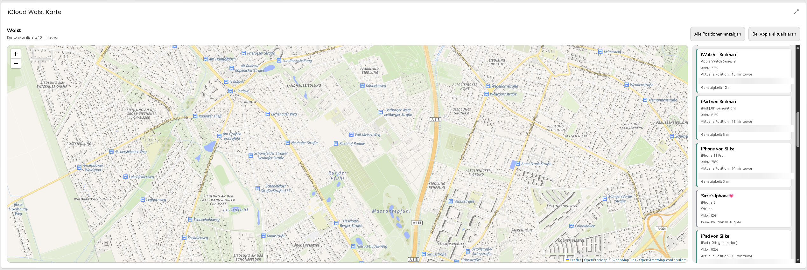

# iCloud WoIst Karte

WoIst zeigt die Positionen der Geräte eines oder mehrerer ausgewählter iCloud-Konten gemeinsam auf einer interaktiven Karte. Einzelne iCloud-Geräteinstanzen sind dafür nicht erforderlich. Voraussetzung sind Symcon 9.0 und mindestens ein angemeldetes iCloud-Konto dieser Library.

*Beispiel einer eingerichteten WoIst-Kachel. Die Karte bleibt unverändert
erkennbar; Adresszeilen sind unkenntlich gemacht und die privaten
Gerätemarkierungen für die Dokumentation entfernt.*

## Einrichtung

1. **iCloud WoIst Karte** anlegen und mit dem gewünschten iCloud-Konto verbinden.
2. Die Instanz zur Symcon-Kachelvisualisierung hinzufügen. Standardmäßig zeigt sie alle Geräte ihres verbundenen Kontos und optional zusätzlich ausgewählter Konten. Unter **Geräteauswahl** lässt sich die Anzeige einschränken.
3. Ein Gerät aus der Liste wählen: Die Karte zentriert sich auf dessen Position, hebt den Marker mit größerem Punkt und stärkerem Rand hervor und öffnet die Gerätedetails. Ein bereits näherer Zoom bleibt erhalten. **Alle Positionen anzeigen** passt den Kartenausschnitt an die verfügbaren Positionen an.

Beim Wechsel wird die vorherige Markierung zurückgesetzt. Die Hervorhebung bleibt bei Datenaktualisierungen erhalten; diese verschieben den gewählten Kartenausschnitt nicht. Ein Gerät ohne verfügbare Position kann in der Liste ausgewählt werden, erzeugt aber keinen Kartenmarker und verschiebt die Karte nicht.

Die Karte erhält neue Daten automatisch vom Konto. **Bei Apple aktualisieren** löst eine ausdrückliche Geräteabfrage über das Konto aus und beachtet dessen Anmeldestatus und Wartezeiten. Das Öffnen der Karte oder des Formulars liest nur den Kontocache und löst keine Apple-Anmeldung aus.

## Nur bestimmte Geräte anzeigen

Die Auswahl gilt gemeinsam für die Kachel und IPSView:

1. **Geräteauswahl** in der WoIst-Konfiguration öffnen.
2. **Alle Geräte anzeigen** ausschalten.
3. Unter **Ausgewählte Geräte** über **Hinzufügen** die gewünschten Geräte
   auswählen. Jeder Eintrag nennt den Gerätenamen sowie Konto und Konto-ID.
4. Die Konfiguration übernehmen.

Nicht ausgewählte Geräte erscheinen weder in der Geräteliste noch auf der
Karte. Auch **Alle Positionen anzeigen** berücksichtigt nur angezeigte Geräte.
Der Kontofilter schränkt diese Auswahl zusätzlich ein. Eine leere Auswahl zeigt
keine Geräte. Neu bei Apple gefundene Geräte werden in diesem Modus erst nach
ausdrücklicher Auswahl angezeigt. **Alle Geräte anzeigen** stellt jederzeit die
vollständige Anzeige wieder her; die gespeicherte Auswahl bleibt erhalten.

Die Geräte stammen aus den vorhandenen Kontocaches. Nach dem Hinzufügen eines
weiteren Kontos zunächst die Konfiguration übernehmen und das Formular erneut
öffnen, damit dessen Geräte angeboten werden. Das Öffnen löst keine Anmeldung
und keine neue Geräteabfrage bei Apple aus. Vorübergehend nicht verfügbare oder
aus einem zugewiesenen Konto entfernte Geräte bleiben in der gespeicherten
Auswahl erhalten und können dort entfernt werden.

Konto und Gerätekennung bestimmen die Zuordnung; Umbenennungen und gleiche
Gerätenamen verschiedener Konten verändern sie nicht. Die Auswahl begrenzt die
Darstellung dieser WoIst-Instanz. Sie verändert weder das Konto noch die
Geräteinstanzen oder deren Adressversorgung. Zoom, Kartenausschnitt und eine
weiterhin sichtbare Geräteauswahl bleiben bei Datenupdates erhalten.

## Reihenfolge der Geräteliste

Die Reihenfolge wird je WoIst-Instanz gespeichert und gilt gemeinsam für Kachel
und IPSView. Unter jeder Gerätekarte befinden sich drei Bedienelemente:

- **↕ Ziehen zum Verschieben:** am Ziehgriff auf ein anderes Gerät ziehen.
  Die Markierung zeigt die Einfügestelle. Am oberen und unteren Listenrand
  scrollt die Liste beim Ziehen automatisch weiter.
- **↑ Nach oben** und **↓ Nach unten:** verschieben das Gerät um einen Platz
  innerhalb der gerade sichtbaren Liste. Alternativ am fokussierten Ziehgriff
  die Pfeiltasten der Tastatur verwenden.

Die Gerätekarte selbst wählt weiterhin das Gerät auf der Karte aus. Zum
normalen Scrollen außerhalb des Ziehgriffs wischen oder das Mausrad verwenden.
Abbrechen eines Ziehvorgangs speichert keine Änderung.

**Alphabetisch sortieren** setzt die Reihenfolge der zugewiesenen Geräte zurück,
auch wenn gerade ein Konto- oder Gerätefilter aktiv ist. Filter allein verändern
die Reihenfolge nicht; beim Verschieben bleiben ausgeblendete Einträge erhalten.
Neu erkannte Geräte werden am Ende ergänzt. Datenupdates, erneutes Öffnen und
Wiederverbindung erhalten die gespeicherte Reihenfolge sowie die weiterhin
sichtbare Geräteauswahl und den gewählten Kartenausschnitt.

Die Sortierung liest nur die vorhandenen Kontocaches. Sie verändert keine
Apple-Daten und löst weder Anmeldung noch Geräteaktualisierung aus.

## Mehrere iCloud-Konten auf einer Karte

Das bisher verbundene **iCloud Konto** bleibt automatisch enthalten. Unter
**Zusätzliche iCloud-Konten → Zusätzliche Konten** können bis zu 20 weitere
vorhandene Kontoinstanzen über ihre Instanz-ID ausgewählt werden. Zugangsdaten
werden ausschließlich in den jeweiligen Kontoinstanzen eingerichtet. Doppelte
Einträge einschließlich des bereits verbundenen Kontos werden nur einmal
berücksichtigt.

Sobald mehrere Konten zugeordnet sind, erscheint in Kachel und IPSView der
**Kontofilter**. **Alle Konten** zeigt die gemeinsame Karte; die Auswahl eines
Kontos begrenzt Geräteliste und Marker auf dieses Konto. Zusätzlich steht der
Kontoname bei den Gerätedetails und im Popup. Gleichnamige Geräte und identische
Gerätekennungen verschiedener Konten bleiben getrennt.

- Vorhandene Einstellungen und Gerätekennungen des verbundenen Kontos bleiben
  erhalten. Bestehende Karten müssen nicht neu eingerichtet werden.
- Datenupdates verändern weder Kontofilter noch Zoom, Kartenausschnitt,
  Geräteauswahl oder Scrollposition. Der Filterwechsel verändert die Kamera
  ebenfalls nicht; **Alle Positionen anzeigen** passt sie ausdrücklich an die
  aktuell sichtbaren Geräte an.
- Ein durch den Filter ausgeblendetes ausgewähltes Gerät bleibt ausgewählt
  und wird beim Zurückwechseln wieder hervorgehoben.
- Beim Wiederaufbau der Seite werden Ansicht, Auswahl, Filter und
  Scrollposition über den zentralen Helper im Sitzungsspeicher desselben
  Browser-Tabs wiederhergestellt. Dieser Speicher ist zeitlich begrenzt;
  private Browser-/WebView-Einstellungen können ihn einschränken.
- Zusätzliche Kontocaches werden alle fünf Sekunden lokal gelesen. Das startet
  keine Apple-Abfrage und keine Anmeldung. Abfrageintervalle, Pausen, Limits
  und Sitzungen bleiben pro Konto getrennt.
- **Bei Apple aktualisieren** fordert einmal eine Aktualisierung aller
  zugeordneten Konten an. Jede Kontoinstanz prüft ihre eigenen Schutzregeln;
  bei mehreren Konten kann der Vorgang länger dauern.
- Ein nicht verfügbares Konto wird im Filter und als Hinweis angezeigt.
  Vorhandene Positionen dieses Kontos gelten als zuletzt bekannt. Gesunde
  Konten bleiben sichtbar und aktuell. Entfernte oder falsch zugeordnete
  Instanzen beeinträchtigen die übrigen Konten nicht.

Der Filter dient der Darstellung und ist keine Zugriffsberechtigung: Wer
Zugriff auf die gemeinsame Karte hat, kann alle zugeordneten Konten sehen.
Bei Änderung der Kontozuordnung erneuert das Modul den IPSView-Zugriffstoken.
Die IPSView-Ausgabe nach dem Übernehmen gegebenenfalls neu öffnen.
Adressvariablen vorhandener Geräteinstanzen verwenden weiterhin deren
ursprüngliche Kontozuordnung; Geräteinstanzen werden nicht zusammengeführt.

## Optionale Adressauflösung

Im Abschnitt **Adressauflösung** kann die Auflösung eingeschaltet und der
**Adressanbieter** gewählt werden. Sie ist standardmäßig deaktiviert;
**Eigener Nominatim-Server** bleibt auch für bestehende Instanzen die Vorgabe.
Es wird ausschließlich der gewählte Anbieter verwendet, ohne automatischen
Wechsel zu einem externen Dienst.

### Eigener Nominatim-Server

Als **Basis-URL** wird die HTTP(S)-URL
eines laufenden eigenen Nominatim-Servers eingetragen, beispielsweise
`http://nominatim.example:8080` oder `https://nominatim.example/osm` bei einem
Reverse-Proxy mit Pfadpräfix. `/reverse` wird automatisch ergänzt. Ein GitHub-Fork
enthält den Servercode und ersetzt keinen eingerichteten Dienst mit importierten
OSM-Daten. Zugangsdaten, Query und Fragment gehören nicht in dieses Feld.
Der öffentliche Dienst `nominatim.openstreetmap.org` wird nicht unterstützt.
Die Adresssprache ist standardmäßig `de`, alternativ beispielsweise `en` oder
`de-DE`.

Nominatim ist ein zusätzlicher Dienst mit einer eigenen OpenStreetMap-Datenbank.
Er wird nicht durch das Anlegen einer WoIst-Instanz installiert. Die Anfragen
kommen vom **Symcon-Server**, nicht von dem Rechner, auf dem die Konsole oder
IPSView geöffnet ist. Nominatim liefert die Adresse; die sichtbare Karte wird
weiterhin von OpenFreeMap bereitgestellt.

#### Praxisbeispiel: Raspberry Pi mit laufendem Symcon

Die Einrichtung wurde am **22.10.2026** auf einem **Raspberry Pi 5 mit 4 GiB RAM
und Debian 12 Bookworm in 64 Bit** erfolgreich durchgeführt. Symcon lief auf
demselben Pi weiter. Für den kleinen regionalen Datenbestand wurde kein Docker
verwendet:

| Bestandteil | Einrichtung im Beispiel |
| --- | --- |
| Gebiet | Geofabrik Brandenburg **einschließlich Berlin** |
| Nominatim | Version 5.3.3, eigene Python-Umgebung unter `/srv/nominatim/venv` |
| Datenbank | Separater PostgreSQL-15-Cluster `nominatim`, Port 5433, nur lokaler Unix-Socket |
| HTTP-Dienst | Gunicorn mit einem Worker auf Port 8088 |
| Import | Adressdaten, nur Koordinaten → Adresse, ein Importthread; keine laufenden OSM-Updates |
| Datenträger | Im Praxislauf microSD; vor Beginn rund 27 GiB frei |
| Ergebnis | Rund 6 Stunden 19 Minuten Importzeit; fertige Datenbank rund 1,5 GiB |

Import, Datenbank und HTTP-Dienst teilen sich eine eigene systemd-Slice:
höchstens **ein CPU-Kern**, **2600 MiB RAM** und **512 MiB zusätzlicher Swap**,
dazu höchstens **8 MB/s Lesen** und **2 MB/s Schreiben** auf dem betroffenen
Datenträger. Ein Freiplatzschutz verlangt vor dem Import mindestens 20 GiB und
bricht ihn unter 8 GiB freiem Platz ab. Die Grenzen reduzieren die Belastung
von Symcon; sie garantieren auf einem gemeinsam genutzten Datenträger keine
unveränderten Reaktionszeiten. Zeit und Speicherbedarf sind Messwerte dieses
Beispiels, keine allgemeinen Mindestwerte oder Zusagen für andere Regionen.

Die [vollständige Raspberry-Pi-Anleitung ohne Docker](../docs/nominatim-raspberry-pi.md)
beschreibt Pakete, Datenbank, Ressourcenlimits, Import, HTTP-Dienst und
LAN-Anbindung mit den zugehörigen Befehlen. Sie ist für eine **Neuinstallation**
gedacht; einen bereits funktionierenden Server nicht erneut importieren.

#### Den laufenden Server mit WoIst verbinden

1. **Adressauflösung** öffnen und **Gerätepositionen in Adressen auflösen** aktivieren.
2. Als **Adressanbieter** **Eigener Nominatim-Server** wählen.
3. Die **Basis-URL des eigenen Nominatim-Servers** passend zum Standort des Symcon-Servers
   eintragen:

   | Wo läuft die anfragende Symcon-Instanz? | Basis-URL |
   | --- | --- |
   | Auf demselben Pi wie Nominatim | `http://127.0.0.1:8088` |
   | Auf einem anderen Rechner, etwa dem Testsystem | `http://<Pi-LAN-IP>:8088` |

   `<Pi-LAN-IP>` durch die tatsächliche LAN-Adresse des Pi ersetzen. Für den
   zweiten Fall muss der HTTP-Dienst zusätzlich auf dieser Adresse lauschen.
   Die Anleitung erklärt die zusätzliche Bindung; die PostgreSQL-Datenbank
   bleibt auch dann ausschließlich lokal erreichbar.
4. **Adresssprache** auf `de` belassen oder anpassen und **Übernehmen** wählen.
   Weder `/reverse` noch Koordinaten oder weitere Parameter an die URL anhängen.
5. Die bereits vorhandenen Gerätepositionen werden im Hintergrund aufgelöst.
   Verfügbare Adressen erscheinen in Geräteliste und Popup; verbundene
   Geräteinstanzen können sie über die Variable **Adresse** verwenden.

`127.0.0.1` bezeichnet immer den Rechner, der die Anfrage ausführt. Auf einem
getrennten Testsystem würde diese URL dessen eigenen Rechner ansprechen und
nicht den Pi. Mehrere Symcon-Systeme können denselben Nominatim-Dienst nutzen;
ein zweiter Datenimport ist dafür nicht erforderlich.

Das sparsame Pi-Beispiel verwendet bewusst `--no-updates`: Es aktualisiert
seinen OSM-Datenbestand nicht automatisch. Neue Apple-Gerätepositionen werden
trotzdem weiterhin aufgelöst. Regelmäßige OSM-Updates oder eine Gebietserweiterung
benötigen eine gesondert geplante Einrichtung; Details stehen in der Anleitung.

### Geoapify ohne eigenen Server

Bei [Geoapify](https://www.geoapify.com/) ein eigenes Konto und einen API-Key
anlegen. Anschließend **Geoapify (externer Dienst)** auswählen, den Key in
**Geoapify-API-Key** eintragen und übernehmen. Eine Nominatim-Serveradresse ist
für diesen Anbieter nicht erforderlich. Der Key bleibt auf dem Symcon-Server
und wird in der Oberfläche verdeckt eingegeben; er gehört nicht in Screenshots,
Logs oder geteilte Konfigurationen. Symcon-Konfiguration und Backups schützen.

Das **Geoapify-Tageslimit je Instanz** beträgt standardmäßig **2.500** und lässt
sich von 0 bis 1.000.000 einstellen. `0` verhindert neue Abfragen. Gezählt werden
tatsächliche HTTP-Versuche einschließlich Fehlern; Cachetreffer kosten kein
Budget. Der Zähler bleibt bei Neustart, Deaktivieren, Cacheleerung und
Schlüsselwechsel erhalten. Der Tageswechsel erfolgt um **00:00 UTC**, unabhängig
von der lokalen Zeitzone. Ausstehende Abfragen werden dann automatisch wieder
aufgenommen, sofern das Limit größer als null ist. Das Formular zeigt den
Verbrauch beim Öffnen; bei ausgeschöpftem Budget erscheint ein Hinweis in der
Karte. Bereits gespeicherte, noch gültige Adressen bleiben verfügbar.

Das lokale Limit ersetzt keine Kontingentprüfung des Anbieters. Bei gemeinsamem
Key die Budgets aller WoIst-Instanzen, Produktiv-/Testsysteme und anderer
Anwendungen zusammen berücksichtigen. Der Anbieter kann eigene Grenzen und
Tarifbedingungen ändern. HTTP-Fehler führen zu einer Wartezeit statt zu
unbegrenzten Wiederholungen.

Geoapify erhält Koordinaten, Sprache und den API-Key; Gerätenamen und
Apple-Zugangsdaten werden nicht übertragen. Regionale Sprachcodes wie `de-DE`
verwenden die Basissprache `de`. Kachel und IPSView zeigen die Quellenangaben
**Powered by Geoapify** und **OpenStreetMap contributors**. Bei selbst gestalteten
Ausgaben mit der Gerätevariable müssen die erforderlichen Quellenhinweise
ebenfalls beibehalten werden.

### Gemeinsames Verhalten beider Anbieter

Beide Anbieter zeigen Adressen kompakt im selben Format an, beispielsweise
**Beispielstraße 7a, 12345 Beispielstadt, Deutschland**. Zusätzliche Orts- und
Verwaltungsebenen entfallen bei Gebäude-/Straßenangaben. Bei Gebietsangaben
erscheint höchstens ein Ortsteil vor PLZ und Ort. Fehlende Bestandteile werden
ausgelassen; auf dem Land kann ein Dorf oder eine Gemeinde den Ort ersetzen.
Die Genauigkeitsgrenzen und der Ungefähr-Hinweis gelten weiterhin.

Nach diesem Update werden bisherige Cachetexte schrittweise neu aufgelöst.
Bis zum passenden neuen Ergebnis kann die Adresse vorübergehend leer sein.
Das Geoapify-Tagesbudget bleibt erhalten; ist es ausgeschöpft, wartet die
Auflösung neuer Cacheeinträge bis zum nächsten UTC-Tag.

Die verbundenen [iCloud-Geräteinstanzen](../iCloud%20Device/README.md#adresse-aus-woist)
können dieselben Cacheergebnisse als Variable **Adresse** übernehmen. Neue
Adressresultate aktualisieren diese Instanzen automatisch; zusätzliche
Anbieterabfragen pro Geräteinstanz sind nicht erforderlich. Bei mehreren
WoIst-Karten mit aktivierter Auflösung am selben Konto wird die gewünschte
Quelle in der Geräteinstanz ausgewählt.

Nach dem Übernehmen erscheinen verfügbare Adressen nach und nach in der
Geräteliste und im Geräte-Popup, sowohl in der Kachel als auch in IPSView.
Die Auflösung erfolgt im Hintergrund mit höchstens einer Abfrage je zwei
Sekunden pro WoIst-Instanz. Eine neue Adresse aktualisiert nur die Daten;
Zoom, Kartenausschnitt, Geräteauswahl und Popup bleiben erhalten.

Übertragen werden Koordinaten und Sprach-/Formatparameter an den ausgewählten
Anbieter, bei Geoapify zusätzlich dessen API-Key. Apple-Zugangsdaten und Gerätekennungen bleiben in
Symcon. Erfolgreiche Adressen werden 24 Stunden persistent gespeichert,
fehlende Treffer eine Stunde. Der zentrale Helper begrenzt den Cache auf
512 Adressresultate; Anbieter, Server beziehungsweise Key, Sprache und Detail sind getrennt. Bei einer neuen Position
verschwindet die alte Adresse sofort. Netzwerk-/Antwortfehler lösen fünf Minuten
Wartezeit aus; ein späteres Konto-/Kartenupdate stößt den nächsten Versuch an.
Die Karte bleibt auch bei Serverausfällen nutzbar. Eine ungültige aktivierte
Konfiguration wird im Formular gemeldet. Deaktivieren und Übernehmen löscht
den privaten Adresscache; Symcon-Konfiguration und Backups entsprechend schützen.

Die von Apple gemeldete Standortgenauigkeit begrenzt die angezeigten Details:

| Standortgenauigkeit | Maximale Adressdetails |
| --- | --- |
| Positiv und bis einschließlich 20 m | Gebäude einschließlich Hausnummer |
| Über 20 bis einschließlich 100 m | Straße, ohne Hausnummer |
| Über 100 bis einschließlich 1000 m | Gebiet/Ortsteil, ohne Straße und Hausnummer |
| Über 1000 m | Ort |
| Fehlend, ungültig oder 0 m | Ort; Genauigkeit ausdrücklich unbekannt |

Alle Angaben oberhalb der Gebäudegrenze erhalten einen hervorgehobenen
**Ungefähr**-Hinweis in Liste und Popup. Die Gerätevariable übernimmt denselben
Hinweis. Bei schlechter werdender Genauigkeit verschwindet eine zuvor bekannte
Hausadresse sofort; passende Angaben erscheinen nach der Hintergrundauflösung.
Die Detailstufen haben getrennte Cacheeinträge. Bereits vor diesem Update
gespeicherte Adressen werden schrittweise neu aufgelöst. Die Detailstufe der
Adressabfrage verändert den Kartenzoom nicht.

Die angezeigte Adresse gehört zur angegebenen, gegebenenfalls älteren Position.
Der Anbieter ermittelt ein geeignetes nahegelegenes Objekt; eine genaue
Hausnummer kann deshalb nicht zugesichert werden. Die OSM-Quellenangabe bleibt
in der Karte sichtbar. Weitere Anbieter außer Nominatim und Geoapify sind derzeit nicht enthalten.

`ICWI_GetDeviceAddress(int $InstanceID, string $DeviceID, float $Latitude,
float $Longitude): string` liest ausschließlich den Adresscache der Karte.
Die Geräte-ID und beide Koordinaten müssen zur aktuell im angemeldeten
Kontocache vorhandenen Position passen. Bei fehlendem Treffer oder deaktivierter
Auflösung ist das Ergebnis leer. Der Aufruf startet weder eine Anbieterabfrage
noch eine Apple-Aktualisierung.

## Kachel- und IPSView-Designer

Im **Kachel-Designer** lassen sich Schriftgröße, Radius und Farben der Standortmarkierungen sowie Überschrift, Geräteliste und Bedienelemente einstellen. Einstellungen anschließend übernehmen. Karte und Geräteliste nutzen die verfügbare Breite und Höhe der Kachel. Auf schmalen Kacheln steht die Liste unter der Karte und scrollt innerhalb ihres Bereichs. Bei ausgeblendeter Liste nutzt die Karte die gesamte freie Fläche. Die bisherige Kartenhöhe dient nur noch als Fallback; die tatsächliche Kachelgröße hat Vorrang. Neue Instanzen verwenden dafür automatisch `0`.

In der nativen Symcon-Kachel wird Platz für deren sichtbare Kachelüberschrift reserviert. Bei ausgeblendeter Kachelüberschrift entfällt dieser Abstand, soweit die Symcon-Version den Zustand bereitstellt. Die HTTP-Seite für IPSView reserviert keinen zusätzlichen nativen Titelbereich.

Für IPSView:

1. Im **IPSView-Designer** die HTML-Ausgabe aktivieren und **Übernehmen** wählen.
2. Die erzeugte String-Variable **WoIst für IPSView** (`IPSViewWoIst`) in IPSView
   als WebContent einbinden. Sie lädt die Karte vom Symcon-Server.
3. Falls der Client die Serveradresse nicht automatisch erkennt, die
   **Symcon-Server-URL für IPSView** wie unten beschrieben eintragen.
4. Farben und Schrift unter **IPSView-Stil** einstellen. Diese gelten unabhängig
   von der Farbgestaltung der nativen Kachel.

**Karteneinstellungen der Kachel verwenden** ist zunächst aktiviert. Gemeint
sind Kartenlayout, Positionsfarben und OpenFreeMap-Profil, nicht sämtliche
IPSView-Farben und Schriften. Für unabhängige Kartenparameter die Option
deaktivieren oder **Gespeichertes Kachel-Design kopieren und unabhängig
bearbeiten** wählen. Die Kopieraktion übernimmt bereits gespeicherte Werte,
speichert die IPSView-Einstellungen und lädt das Formular neu. Nach einem
Modulupdate die Instanzkonfiguration einmal übernehmen, damit vorhandene
HTML-Ausgaben den aktuellen Stand enthalten.

Die Kartenseite besitzt eine eigene HTTP(S)-Adresse. Dadurch können Kartenanfragen den tatsächlichen Symcon-Server-Ursprung als Referer mitsenden, auch wenn die äußere IPSView-Ausgabe als `data:`-Seite eingebettet ist. Der Kartenanbieter und dessen Nutzungsbedingungen gelten weiterhin; eine bereits bestehende Sperre wird dadurch nicht garantiert aufgehoben.

Die geöffnete IPSView-Karte liest alle fünf Sekunden ausschließlich den gespeicherten WoIst-Zustand über einen geschützten WebHook. Neue Kontodaten aktualisieren Marker und Liste innerhalb derselben Seite. Zoom, Kartenausschnitt und die Auswahl eines weiterhin gelisteten Geräts bleiben erhalten; auch eine bewegte ausgewählte Position zieht die Karte nicht automatisch mit. Geräte ohne Position bleiben auswählbar in der Liste. Wird ein Gerät aus der Kontoliste entfernt, wird seine Auswahl aufgehoben. **Alle Positionen anzeigen** und eine bewusste Geräteauswahl ändern weiterhin den Kartenausschnitt.

Unter **Symcon-Server-URL für IPSView** bei Bedarf die aus IPSView erreichbare Server-Adresse einschließlich HTTP(S) und gegebenenfalls Port, aber ohne Pfad eintragen. Beispiele: `http://symcon-server:3777` (Servernamen ersetzen) oder `https://symcon.example.org` bei einem Reverse-Proxy. Kein `/hook/...` anhängen; diesen Pfad ergänzt das Modul selbst. Bei eingebetteten `data:`-/`about:`-Seiten ermittelt die Ausgabe den Ursprung automatisch über den zentralen Helper aus Elternfenster, Vorfahren oder Referrer. Nur wenn diese Informationen fehlen, etwa in einer nativen IPSView-App, ist die manuelle Adresse erforderlich. In einer HTTP(S)-Seite auf demselben Symcon-Server darf das Feld leer bleiben. HTTPS verwenden, wenn der Zugriff nicht über ein vertrauenswürdiges lokales Netzwerk erfolgt. Der Browser muss diese Adresse erreichen können; HTTPS-Seiten können HTTP-Abfragen blockieren.

Bei Verbindungsproblemen zeigt die Karte einen Hinweis, behält den letzten Zustand und versucht die Abfrage erneut, ohne die Seite neu zu laden. Bei ausgeblendeter Seite pausiert sie die Abfragen. Diese Abfragen lösen weder eine Apple-Anmeldung noch einen zusätzlichen Geräteabruf aus. Mit **Bei Apple aktualisieren** kann auch in IPSView eine ausdrückliche Geräteabfrage angefordert werden. Der Button ist während des Aufrufs gesperrt; Anmeldestatus und Wartezeit prüft weiterhin das Kontomodul. Die Antwort aktualisiert nur die Kartendaten und erhält Zoom, Kartenausschnitt und Geräteauswahl. Fehlgeschlagene Apple-Aufrufe werden nicht automatisch wiederholt. Nur Änderungen an der Instanzkonfiguration oder eine ausdrücklich angeforderte Neuerzeugung können das HTML-Dokument ersetzen.

Der WebHook akzeptiert token-geschützte Kartenabfragen sowie einen festen POST-Aufruf für die ausdrückliche Apple-Aktualisierung. Normale Abfragen lesen ausschließlich den Kontocache. Andere Fernaktionen sind nicht verfügbar. Dieser Token ist unabhängig von der Apple-Sitzung und wird in der IPSView-Einbindung gespeichert; diese Ausgabe deshalb vertraulich behandeln. Die Einbindung übergibt ihn als URL-Fragment an die Kartenseite. Das Fragment wird vor den ersten Abfragen aus der Seitenadresse entfernt und nicht an den HTTP-Server oder Kartenanbieter gesendet. Datenabrufe verwenden anschließend ausschließlich den Token-Header. Die öffentlich abrufbare Kartenseite selbst enthält weder Token noch Geräte-, Standort- oder private Anbieterparameter. Beim Deaktivieren der Ausgabe oder beim Wechsel des verbundenen Kontos verliert der bisherige Token seine Gültigkeit.

Beim Deaktivieren bleibt die HTML-Variable mit ihrem letzten Inhalt erhalten und wird nicht weiter aktualisiert. Sie kann über die dann angebotene Löschfunktion des Ausgabe-Helpers entfernt werden. Die gespeicherte HTML-Einbindung enthält den Zugriffstoken für Kartenabfragen und die ausdrückliche Aktualisierung; die üblichen Symcon-Zugriffsrechte und der Schutz von Backups gelten auch für diese Variable. Die native Kachel verwendet weiterhin das Symcon-HTML-SDK.

## OpenFreeMap in beiden Designern

Sowohl **Kachel-Designer → OpenFreeMap** als auch **IPSView-Designer → OpenFreeMap** besitzen ein eigenes Kartenprofil:

- **Kartendarstellung:** Designer-Darstellung übernehmen, Hell oder Dunkel. Die Automatik folgt dem tatsächlichen Hintergrund der jeweiligen Ausgabe und reagiert auf Theme-Wechsel.
- **Heller/dunkler Kartenstil:** Liberty, Bright, Positron, Fiord oder Dark. Standard sind Liberty für helle und Dark für dunkle Ansichten.
- **Eigene Stil-URL:** Optional eine HTTPS-Adresse zu einer MapLibre-Stil-JSON, getrennt für Hell und Dunkel. Eine eigene URL ersetzt die jeweilige Stil-Auswahl. Die Datei muss aus dem Browser erreichbar sein und passende CORS-Freigaben besitzen. Eigene Stile können etwa mit [Maputnik](https://maputnik.github.io/) erstellt werden.
- **Kartendetails:** Beschriftungen, Sehenswürdigkeiten/Orte, Gebäude und Verwaltungsgrenzen unabhängig anzeigen; Namen lokal, deutsch oder englisch darstellen. Fehlende Übersetzungen fallen auf vorhandene Namen zurück.
- **Eigene Kartenfarben:** Aktivieren und anschließend getrennte helle/dunkle Farben für Land, Wasser, Grünflächen, Straßen, Gebäude und Beschriftungen wählen. Ohne diese Option gelten die Originalfarben des gewählten Stils. Die Anpassungen wirken auf passende Vektorebenen; die Quellenangabe bleibt sichtbar.

**Karteneinstellungen der Kachel verwenden** übernimmt auch das
OpenFreeMap-Profil. Die Kopierfunktion kopiert dessen Kartenfarben und
Detailoptionen sowie die übrigen Kartenparameter in das unabhängige
IPSView-Profil. Der IPSView-Stil für Bedienelemente und Schrift bleibt separat.
Daten-, Stil-, Farb- und Theme-Wechsel erhalten Zoom, Kartenausschnitt,
Geräteauswahl und ein geöffnetes Gerätepopup.

Die OpenFreeMap-Vektorkarte wird mit lokal gebündeltem MapLibre und Leaflet dargestellt. Ein Browser beziehungsweise WebView mit WebGL-Unterstützung wird benötigt.

## Daten und Aktualität

Die Karte verwendet die von Apple zuletzt gelieferten Koordinaten. Aktuelle und ältere Positionen sind unterschiedlich markiert. Zu jeder Position werden Zeitpunkt und, soweit verfügbar, Genauigkeit angezeigt. Geräte ohne Position bleiben in der Liste sichtbar, erhalten aber keinen erfundenen Kartenpunkt. Offline-Geräte können eine letzte bekannte Position besitzen.

Ein aktueller Kontoabruf bedeutet nicht automatisch eine aktuelle Geräteposition. Nach Ablauf der Altersgrenze oder bei Kontofehlern gelten angezeigte Positionen als letzte bekannte Standorte. Die vorhandene Kontoabfrage fordert keine aktive Neuortung an; eine Live-GPS-Verfolgung oder die vollständige Funktionalität der Apple-App wird nicht zugesagt.

## Konfiguration

| Eigenschaft | Standard | Bedeutung |
| --- | --- | --- |
| `StaleAfter` | 900 | Positionen nach dieser Anzahl Sekunden als älter markieren; 60 bis 86400 |
| `IPSViewServerURL` | leer | Aus IPSView erreichbare HTTP(S)-Server-Adresse ohne Pfad; leer nutzt die eigene HTTP(S)-Seitenadresse |

OpenFreeMap ist der Kartenanbieter; die Kartendaten stammen von OpenStreetMap. Internetzugriff im Browser ist erforderlich. Der Anbieter erhält IP-Adresse und angefragte Kartenregion, aber keine Gerätenamen, Apple-Zugangsdaten oder Zugriffstokens. Leaflet, MapLibre und die Anbindung werden lokal mit der Library ausgeliefert; JavaScript wird nicht von einem CDN geladen. Die OpenFreeMap- und OpenStreetMap-Quellenangaben bleiben sichtbar. Die bisherigen Rasterkachel-Einstellungen werden durch die OpenFreeMap-Profile ersetzt.

Ein eigener Apple-Maps-Hintergrund ist nicht enthalten. Apple MapKit JS benötigt einen separaten Maps-Token aus einem Apple-Developer-Account; die iCloud-Anmeldung ersetzt diesen nicht.

## Öffentliche Funktionen

| Funktion | Rückgabe | Wirkung |
| --- | --- | --- |
| `ICWI_Update(int $InstanceID)` | bool | Kontocache lesen und offene Karten aktualisieren |
| `ICWI_RefreshDevices(int $InstanceID)` | bool | Einmalige ausdrückliche Abfrage über das Konto |
| `ICWI_GetState(int $InstanceID)` | string | JSON mit Kartendaten, Beschriftungen und Kartenoptionen aus dem Cache |

Das Modul erzeugt keine Gerätevariablen; die optionale IPSView-HTML-Variable dient nur der Darstellung. Status 201 bezeichnet ein fehlendes Konto, 202 nicht verfügbare Kontodaten und 203 eine ungültige Kartenkonfiguration. Alte Positionen können bei einem Kontofehler weiterhin zur Einordnung angezeigt werden.

Die native Kachel merkt sich Zoom, Kartenausschnitt, Geräteauswahl und Popup für einen iframe-Neuaufbau bei Verbindungsunterbrechungen im aktuellen Browser-Tab. Der Zustand ist nach Instanz, Kontoverbindung und Visualisierung getrennt und läuft nach vier Stunden ohne Speicherung ab. Beim Schließen des Tabs endet die Speicherung. Der Browser muss Sitzungsspeicher erlauben; ohne ihn bleibt die Karte nutzbar, kann ihre Ansicht nach einem iframe-Neuaufbau aber nicht wiederherstellen. Es werden keine Zugangsdaten gespeichert.

## Serveradresse und Einbettung

Die benötigte HTTP-Route wird vom Modul automatisch registriert. Dafür keinen
eigenen benutzerdefinierten WebHook und kein zusätzliches Skript anlegen.
Bei deaktivierter IPSView-Ausgabe ist der Zugriff gesperrt.

Eine Server-IP wird nicht grundsätzlich benötigt: In einer HTTP(S)-Seite auf demselben Server verwendet die Einbindung automatisch den aktuellen Ursprung. Bei `data:`-/`about:`-Einbettungen verwendet die Ausgabe automatisch den verfügbaren HTTP(S)-Ursprung des einbettenden Kontexts. Native IPSView-Apps ohne solche Browserinformationen benötigen die vom Anzeigegerät erreichbare Serveradresse. Das kann auch ein DNS-Name oder eine HTTPS-Adresse über einen Reverse-Proxy sein. Eine automatisch ermittelte lokale IP wäre außerhalb des lokalen Netzes unter Umständen nicht erreichbar.

Bei einer Meldung über nicht verfügbare Kartendateien das vollständige
SymconiCloud-Modulupdate installieren. Die benötigten Dateien sind enthalten
und müssen nicht einzeln heruntergeladen werden.

### Farben und IPSView-Stil

Der Kachel-Designer enthält den zentralen Bereich **Kachelfarben** für Text, Überschriften, Hintergrund, Akzent und Statusfarben. Ohne eigene Farben folgt die Ausgabe weiterhin dem nativen Symcon-Design einschließlich Hell-/Dunkelwechsel.

Im IPSView-Designer bietet **IPSView-Stil** die zentralen Stilquellen: eigene Einstellungen, eine IPSView-Mediendatei, ein Stilprofil sowie helle, dunkle und weitere vorgegebene Farbpaletten. Einstellbar sind unter anderem Ansicht und Seitenhintergrund, aktive/inaktive Bedienelemente und Texte, Akzent- und Statusfarben, Popups, Transparenz, Schrift, Schriftgröße/-skalierung, Rahmen und Schatten. Die erweiterten nativen Farben zeigen die für Kartenbedienelemente und Popups relevanten Familien. Nicht jede Rolle wird von jeder Kartenkomponente benötigt.

**Karteneinstellungen der Kachel verwenden** und die Kopieraktion betreffen
Kartenlayout, Positionsmarker und OpenFreeMap-Profil. IPSView-Farben und Schrift
bleiben davon unabhängig; die Schriftgröße wird unter **IPSView-Stil** eingestellt.
Eine gewählte Medien-Stilquelle wird bei Medienänderungen neu eingelesen.
Einstellungen nach dem Bearbeiten übernehmen; bei einer geänderten Stilquelle
das Formular neu öffnen, um deren passende Bearbeitungsfelder zu sehen.

Farbänderungen werden in die bestehende Karte übertragen. Zoom, Kartenausschnitt und Geräteauswahl werden dabei nicht zurückgesetzt. OpenFreeMap besitzt weiterhin einen eigenen Menüpunkt in beiden Designern und folgt im Automatikmodus der wirksamen Hintergrundhelligkeit.

### Farbzuordnung im IPSView-Designer

Unter **IPSView-Designer → Farbzuordnung: WoIst-Karte** zeigt eine eigene,
nummerierte Kartenillustration die Farbzuordnungen für Bedienleiste, Karte,
Geräteliste, Popup und Positionsmarker. Bild und Legende verwenden dieselben
deutschen Feldnamen wie der Designer, ergänzt um technische Rollennamen.
Im englischen Designer stehen englische Beschriftungen. Die Farben sind
schematische Beispiele, keine Live-Vorschau ungespeicherter Einstellungen.

Die Farbkarte enthält 19 Zuordnungen in zwei Bereichen:

- **IPSView-Stil:** Hintergründe, Textarten, Auswahlrahmen, Warnhinweise,
  Popup, Zoomtasten, Rahmen und Schatten.
- **Positionsfarben:** **Farbe aktueller Positionen** und
  **Farbe letzter bekannter Positionen** für Marker und Gerätestreifen.
  Der Genauigkeitskreis verwendet die aktuelle Positionsfarbe mit 8 %
  Fülldeckkraft. Markerränder sind fest weiß; **Akzentfarbe** umrandet die
  ausgewählte Gerätekarte und färbt nicht den Marker.

Die OpenFreeMap-Farben werden direkt unter **OpenFreeMap → Helle Kartenfarben**
beziehungsweise **Dunkle Kartenfarben** beschriftet und eingestellt. Sie haben
keine zusätzlichen Nummern oder Legendeneinträge in der Farbzuordnung;
die schematische Karte bleibt als Anschauung erhalten.

Ist **Karteneinstellungen der Kachel verwenden** aktiv, stammen Positionsfarben
und OpenFreeMap-Profil aus der Kachel. Der IPSView-Stil bleibt unabhängig.
Die beschriftete Beispielkarte benötigt keine Kartenabfragen oder privaten
Geräte-/Standortdaten und erscheint nur im Designer.

### Mausradbedienung in IPSView

Das Mausrad über der Karte ändert den Zoom. Über der Geräteliste scrollt es
dagegen die Liste, ohne gleichzeitig die Karte zu zoomen. Den Mauszeiger dafür
über den gewünschten Bereich bewegen. Die Bedienung wird auch in der nativen
IPSView-App unterstützt. Tastenkombinationen mit Strg beziehungsweise Meta
bleiben der umgebenden Anwendung überlassen.

## Lizenz

Eigenes Modul: [PolyForm Noncommercial License 1.0.0](../LICENSE).
Leaflet 1.9.4: BSD-2-Clause, siehe [Leaflet-Lizenz](../libs/vendor/leaflet/LICENSE).
Weitere Kartenkomponenten: [Lizenzhinweise](../libs/helper/maps/vendor/NOTICE.json).
Kartendaten: [© OpenStreetMap contributors](https://www.openstreetmap.org/copyright).
